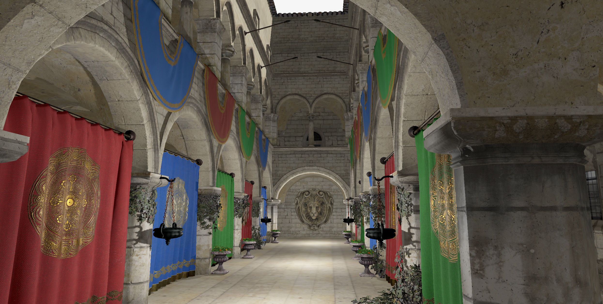

# Sponza

## Technology showcase

In **Open Render Graph Editor**, choose **Built-in Sample → Sponza / Technology Showcase**. The opening view looks down the courtyard across a soft cloud shadow. The near paving sits under the cloud and the far end catches direct sun. The scene also shows projected decals, a low fog bank with a shadowed lamp, and warm and cool rectangular area lights. Lumen provides indirect light for the surfaces and the fog.

Under **Scene Browser → Scene List → Cameras**, select **Courtyard Cloud Shadows** to recall the opening view, or choose **Overview**, **Floor Decals**, or **Fog & Rect Lights**. Click **Use as Viewport Camera** in the inspector. Toggle **Volumetric clouds** in **Environment** to compare the sunlit paving at the same exposure. The wind speed starts at zero to hold the cloud edge in place.

For the other comparisons, toggle the decals in the scene browser, the fog in **Environment**, or **Warm floor wash** and **Cool arcade wash** in the lighting controls.

## Screenshot

Lights are shown here, they are not part of the model.



## Model notes

Tangents have been computed using MikkTSpace, as the original OBJ model did not have them.
I have manually inspected the normals, and it looks correct to me.


## Sources

### https://www.cryengine.com/marketplace/

- https://www.cryengine.com/marketplace/product/CEMP-1102

### http://www.alexandre-pestana.com/pbr-textures-sponza/

- www.alexandre-pestana.com/downloads/SponzaPBR_Textures.rar

I needed to resize some of the alpha mask textures to the 1024x1024 resolution used by the new texture pack,
and merge in diffuse with alpha.
I also repacked the separate metallic/roughness textures into the glTF layout (G - roughness, B - metallic).
The images are also re-encoded as PNG instead of TGA.
All the materials also had a constant diffuse factor of about 0.58. I assume it was supposed to be there, so I kept it.
I also ran the vertices and indices through a mesh optimizer.

## Licensing notes

Taken from copyright.txt in SponzaPBR\_Textures.rar

```
PBR textures for the Sponza model.
For more informations: www.alexandre-pestana.com


Original copyright:

July 14, 2011 Morgan McGuire modified the model from Crytek's OBJ
export to correct some small errors.  He computed bump maps from the
normal maps using <a
href="http://cs.williams.edu/~morgan/code/">normal2bump.cpp</a> (since
MTL files expect height bumps, not normals), put the "mask" textures
into the alpha channel of the associated diffuse texture, cleaned up
noise in the masks, created the missing gi_flag.tga texture, and
removed the long untextured banner floating in the middle of the
atrium that appears in the file but in none of the published images of
the model.  The banner is in banner.obj.


http://www.crytek.com/cryengine/cryengine3/downloads


Sponza Model
August 19, 2010
The Atrium Sponza Palace, Dubrovnik, is an elegant and improved model created by Frank Meinl. The original Sponza model was created by Marko Dabrovic in early 2002. Over the years, the Sponza Atrium scene has become one of the most popular 3D scenes for testing global illumination and radiosity due to it's specific architectural structure which is particularly complex for global illumination light.

However, nowadays it is considered as a simple model, thus it was decided to crate a new model with highly improved appearance and scene complexity. It is donated to the public for  radiosity and is represented in several different formats (3ds, Obj) for use with various commercial 3D applications and renderers.


Screenshot from the I3D paper
http://crytek.com/sites/default/files/20100301_lpv.pdf
```
