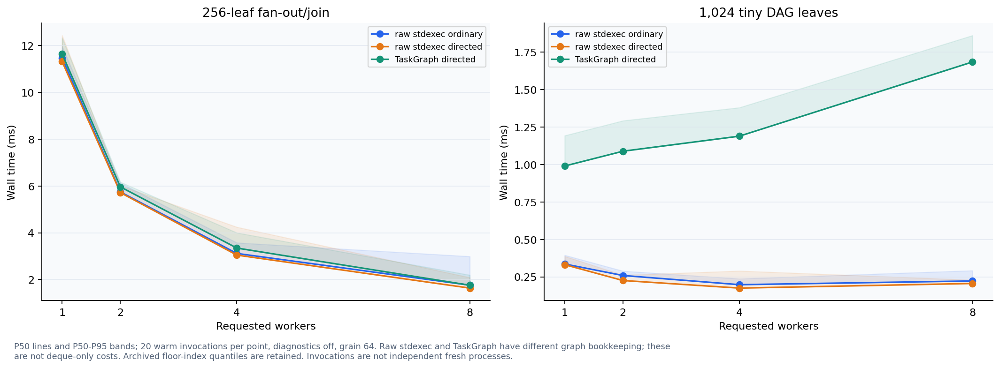
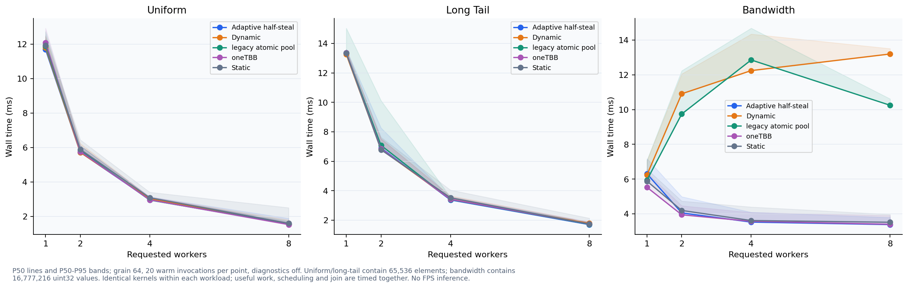
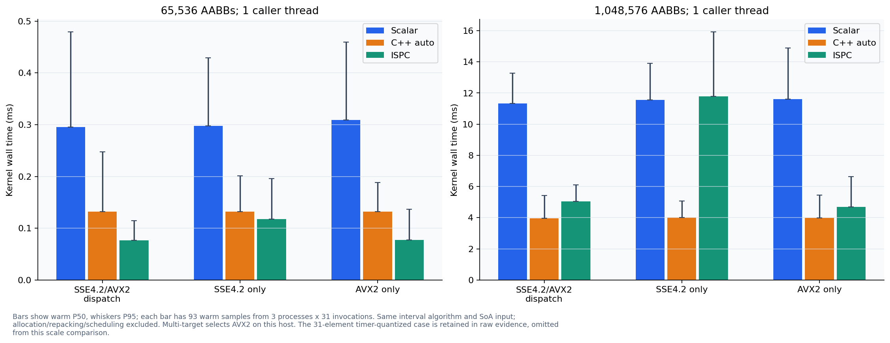
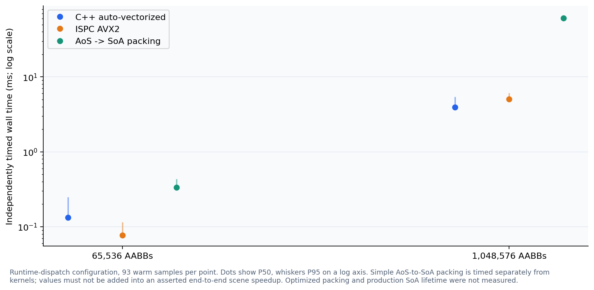
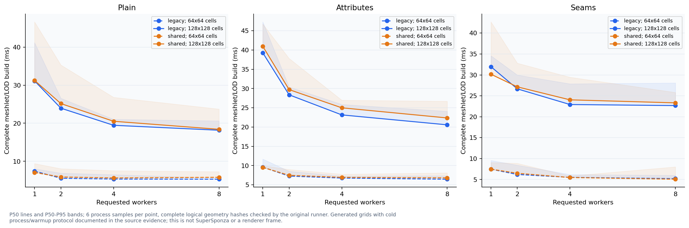

# CPU jobs archived scheduler, range, SIMD and generated meshlet measurements

Generated from immutable evidence; no renderer or benchmark was executed.

- P50/P95/P99 summarize the recorded sample population, not confidence intervals. Missing data is never replaced with zero.
- Budgets: frameMs=not supplied; cpuMemoryMiB=not supplied; vramMiB=not supplied
- Historical plots use archived 2026-11-06 evidence from C:\Users\11252\.codex\worktrees\3379\metallic\Documentation\Measurements\CPUJobs20261106; they are separate workloads and binaries from production A/B.

## Archived scheduler baseline

P50 lines and P50-P95 bands; 20 warm invocations per point, diagnostics off, grain 64. Raw stdexec and TaskGraph have different graph bookkeeping; these are not deque-only costs. Archived floor-index quantiles are retained. Invocations are not independent fresh processes.

## Archived range strategies

P50 lines and P50-P95 bands; grain 64, 20 warm invocations per point, diagnostics off. Uniform/long-tail contain 65,536 elements; bandwidth contains 16,777,216 uint32 values. Identical kernels within each workload; useful work, scheduling and join are timed together. No FPS inference.

## Archived SIMD kernel isolation

Bars show warm P50, whiskers P95; each bar has 93 warm samples from 3 processes x 31 invocations. Same interval algorithm and SoA input; allocation/repacking/scheduling excluded. Multi-target selects AVX2 on this host. The 31-element timer-quantized case is retained in raw evidence, omitted from this scale comparison.

## Archived layout-conversion cost

Runtime-dispatch configuration, 93 warm samples per point. Dots show P50, whiskers P95 on a log axis. Simple AoS-to-SoA packing is timed separately from kernels; values must not be added into an asserted end-to-end scene speedup. Optimized packing and production SoA lifetime were not measured.

## Archived generated geometry cooker

P50 lines and P50-P95 bands; 6 process samples per point, complete logical geometry hashes checked by the original runner. Generated grids with cold process/warmup protocol documented in the source evidence; this is not SuperSponza or a renderer frame.

## Archived comparison executable identities

| Evidence set | Candidate | Executable SHA256 |
| --- | --- | --- |
| Baseline | benchmark executable | 1622211e719cebc7cd3188c987fae41aec64bab272c8b27754718049a1601295 |
| SmallTasks | benchmark executable | 1622211e719cebc7cd3188c987fae41aec64bab272c8b27754718049a1601295 |
| Range | benchmark executable | 1622211e719cebc7cd3188c987fae41aec64bab272c8b27754718049a1601295 |
| Kernels | multi | faaf53d5bd39d97907614ad8895eb01f297beed18f91793e0b6a182717427626 |
| Kernels | sse4 | 16b0f850a3c43961d0fe1a9573eae61ddc2c5c9c217142e24664216039aeb6c5 |
| Kernels | avx2 | af65160a81ad9b17cfc790748afacd6f3359abc5bc70c3f215bff6fe0380ef71 |
| Meshlet | shared | 520345e8e13ce217e7627e1d2675fca15cbff2c7e43eba3920e588d8beeef7ef |
| Meshlet | legacy | d70a7d1a7b6a098607ac26aa5c246853000efcda8d5a61734868b21d1fd53c4c |

[Input and plot provenance](PlotManifest.json)
