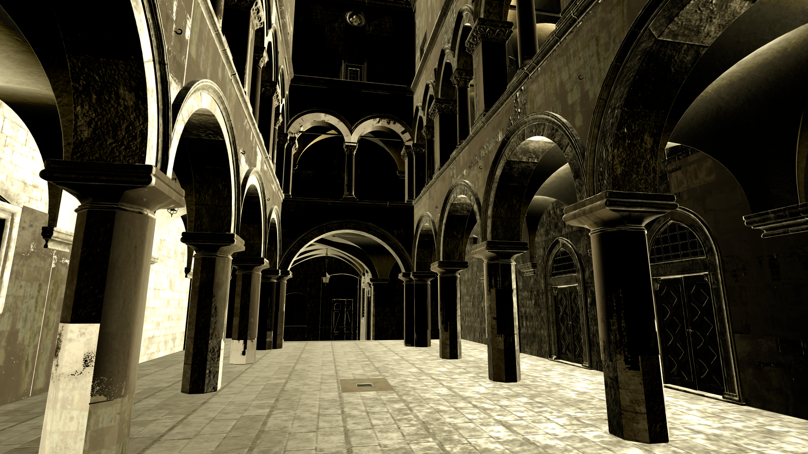

# SuperSponza residency and correctness soak gate

Gate passed for four fresh-process ABBA runs (legacy, shared, shared, legacy), each with 180 warmup frames and 6000 captured frames, IDs 181–6180, at eight workers. These runs enabled scheduling diagnostics and are not an ordinary FPS performance A/B. The checks launched no renderer or benchmark.

Every captured frame has one finite RenderGraph GPU envelope and one streaming observation. Across all 24,000 streaming observations, `loadFailures`, `allocationFailures`, `pendingPages`, `texturePendingBytes` and `texturePendingImages` are zero. Every device-memory snapshot reports zero denied allocations (601 measured snapshots per process, plus the exported after-load/warmup/capture snapshots). Missing per-frame memory values were not filled with zero.

All four processes retain the same observed state throughout their captured frames and their final 600-frame interval:

| Observed quantity | First and last value in each process | Final 600 frames |
| --- | ---: | --- |
| Resident geometry pages | 1636 | Constant, 600 observations |
| Resident geometry bytes | 44,835,328 | Constant, 600 observations |
| Allocated CLAS bytes | 67,108,864 | Constant, 600 observations |
| Resident texture bytes | 6,442,574,336 | Constant, 600 observations |
| Current RHI tracked device-local bytes | 7,555,871,296 | Constant, 61 snapshots |
| RHI tracked device-local lifetime high-water bytes | 7,632,450,464 | Constant, 61 snapshots |
| Current RHI tracked host plus device bytes | 7,561,348,448 | Constant, 61 snapshots |
| RHI tracked host plus device lifetime high-water bytes | 7,637,927,616 | Constant, 61 snapshots |

This establishes an observed plateau for this fixed view and capture interval. RHI tracking excludes untracked native, SDK and driver allocations; sampled current values cannot establish all transients. Texture bytes are one residency component, not total VRAM.

Capture identities match across all four processes: scene, camera, effective graph, worker/recording limits, 1920×1080 output and 1280×720 internal render extent. Exported per-frame graph generation and streaming asset identity are constant. Frames do not redundantly export scene/camera/extents. Separately, `EditorCPUJobBenchmark.cpp` checks viewport output extent and graph-generation stability after each captured draw and throws on violations; the four captures have passed status. This distinguishes exported-field checks from the application's runtime invariant checks.

Actual DAG clocks show each process has 1683 `MeshletStreamPageLoad` graphs before the measurement envelope and 6181 `Prepare VBuffer` graphs overall. Exactly 6000 `Prepare VBuffer` graphs per process are fully contained in the measured envelope. Steady-state prepare work therefore executes in these normal-mode runs; the page-loading work is outside the captured steady-state interval. Graph counts do not establish a summed CPU critical path.

All four final native RGBA16F scRGB images are finite and have alpha exactly one. They share the same final frame ID 6180 and have small raw-coordinate differences:

| Pair | Role | RGB mean absolute difference | RGB RMS difference | Maximum absolute RGB difference |
| --- | --- | ---: | ---: | ---: |
| Legacy 0 / shared 1 | Cross backend | 0.0000277391 | 0.0002653060 | 0.05078125 |
| Shared 2 / legacy 3 | Cross backend | 0.0000274558 | 0.0002628739 | 0.06396484 |
| Legacy 0 / legacy 3 | Same backend repeat | 0.0000286419 | 0.0002753271 | 0.06396484 |
| Shared 1 / shared 2 | Same backend repeat | 0.0000272627 | 0.0002611187 | 0.05175781 |

The cross-backend differences are on the scale of the same-backend repeats in these four exports. This is a diagnostic comparison, not a bitwise equality requirement or a statistical equivalence test. The preview shows coherent Sponza arches, columns, floor and textured walls, without obvious missing blocks or error colors. One fixed-view preview does not establish all views or temporal stability.



The preview clips native RGB to [0,1], then applies the linear Rec709-to-sRGB transfer without auto exposure or tone mapping. The native scRGB values extend outside [0,1], which is not itself an error.

Detailed counts, first/last/range values, final-window values, image statistics and input hashes are in [Audit.json](Audit.json) and [TaskGraphAudit.json](TaskGraphAudit.json). The exact scripts are retained beside them. After restoring the full original raw layout, reproduce in a new directory:

```powershell
python -B AuditSoak.py --input <restored-soak-root> --output <new-audit-directory>
python -B AuditTaskGraphOverlap.py <restored-soak-root> <new-audit-directory>/TaskGraphAudit.json
```
