# SuperSponza instrumented residency soak: diagnostic telemetry, not ordinary FPS

Generated from immutable evidence; no renderer or benchmark was executed.

- P50/P95/P99 summarize the recorded sample population, not confidence intervals. Missing data is never replaced with zero.
- Budgets: frameMs=not supplied; cpuMemoryMiB=not supplied; vramMiB=not supplied
- Production input purpose=performance; scheduling diagnostics=on; app diagnostic sink=True. Validation and performance populations are not mixed.
- Production: 4 passed measured processes; 0 prewarm/failed/incomplete records excluded from latency comparisons. Frames are correlated within a process; per-process quantiles are plotted individually, never pooled as independent experiments.
- Production worker limits: [8]; W labels identify each limit. No results are averaged across different worker limits, blocks or executable candidates.
- SceneLoad console step durations are independent producer-owned envelopes; order is console occurrence, not a shared-clock timeline. They may include nested or overlapping work and are not summed into total loading. Separate PNG decode, mip generation and upload boundaries are NA: the available logs do not establish complete independent intervals for these stages.
- A TaskGraph/DAG critical path is unavailable unless dependency-linked task intervals are separately recorded. Inclusive profiler scope durations alone do not establish that path.

## Production initialization, loading and process lifetime

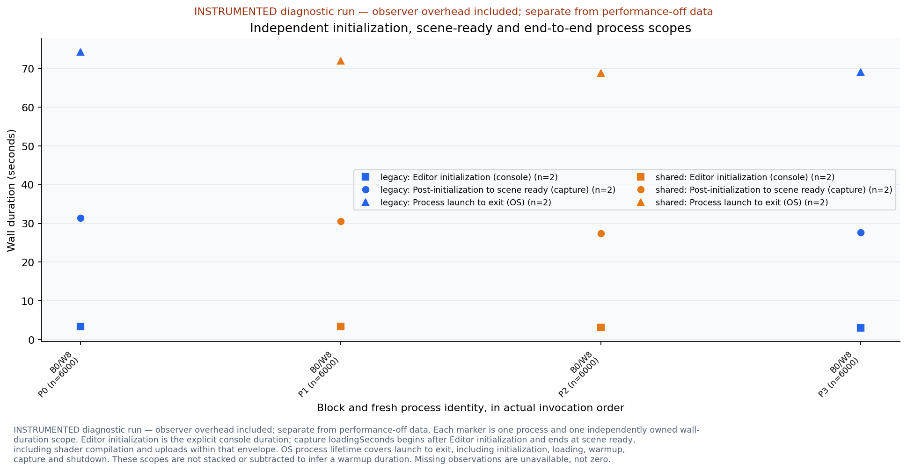

INSTRUMENTED diagnostic run — observer overhead included; separate from performance-off data. Each marker is one process and one independently owned wall-duration scope. Editor initialization is the explicit console duration; capture loadingSeconds begins after Editor initialization and ends at scene ready, including shader compilation and uploads within that envelope. OS process lifetime covers launch to exit, including initialization, loading, warmup, capture and shutdown. These scopes are not stacked or subtracted to infer a warmup duration. Missing observations are unavailable, not zero.

## Production frame distributions by process/block

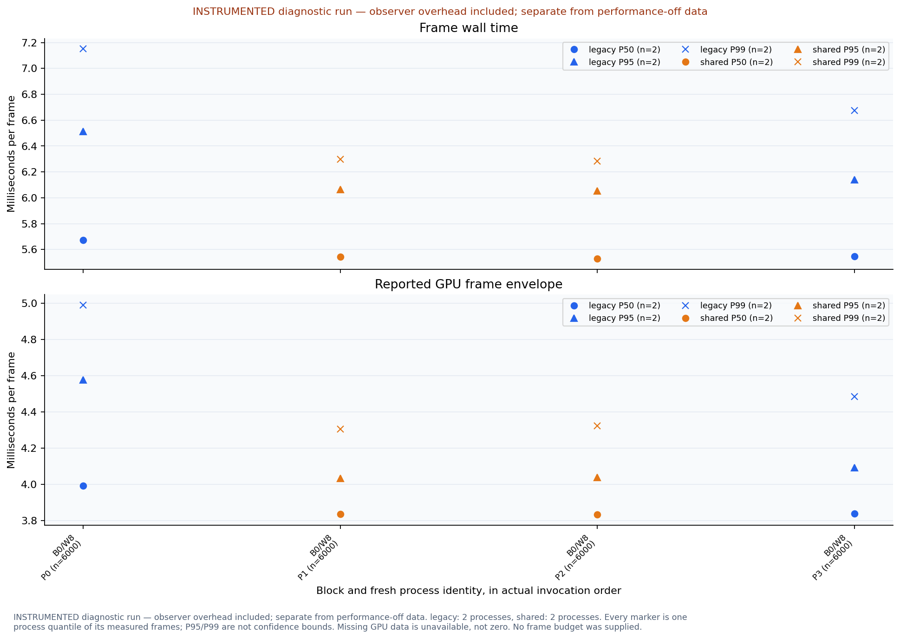

INSTRUMENTED diagnostic run — observer overhead included; separate from performance-off data. legacy: 2 processes, shared: 2 processes. Every marker is one process quantile of its measured frames; P95/P99 are not confidence bounds. Missing GPU data is unavailable, not zero. No frame budget was supplied.

## Production recorded frame time series, page 1

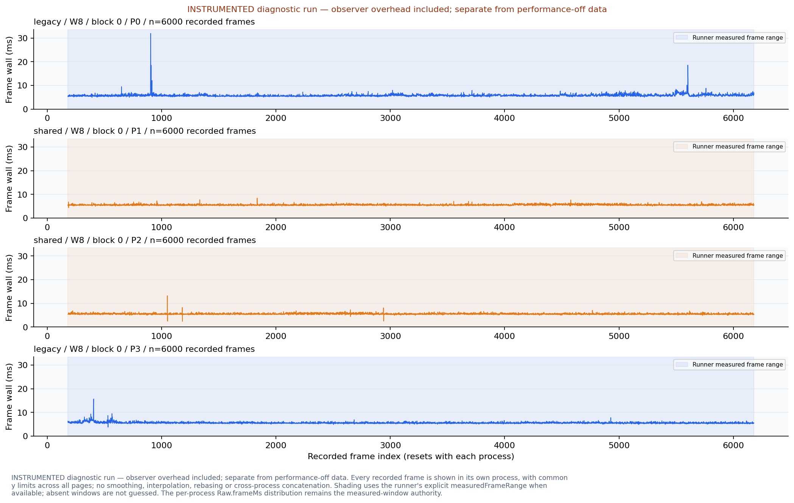

INSTRUMENTED diagnostic run — observer overhead included; separate from performance-off data. Every recorded frame is shown in its own process, with common y limits across all pages; no smoothing, interpolation, rebasing or cross-process concatenation. Shading uses the runner's explicit measuredFrameRange when available; absent windows are not guessed. The per-process Raw.frameMs distribution remains the measured-window authority.

## Production CPU scope wall durations

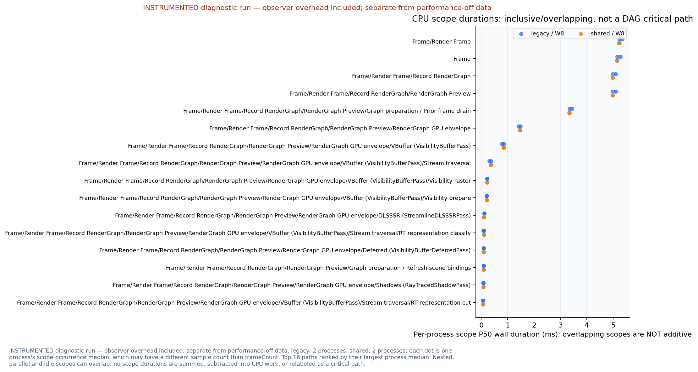

INSTRUMENTED diagnostic run — observer overhead included; separate from performance-off data. legacy: 2 processes, shared: 2 processes; each dot is one process's scope-occurrence median, which may have a different sample count than frameCount. Top 16 paths ranked by their largest process median. Nested, parallel and idle scopes can overlap; no scope durations are summed, subtracted into CPU work, or relabeled as a critical path.

## Production non-overlapping coordinator frame path

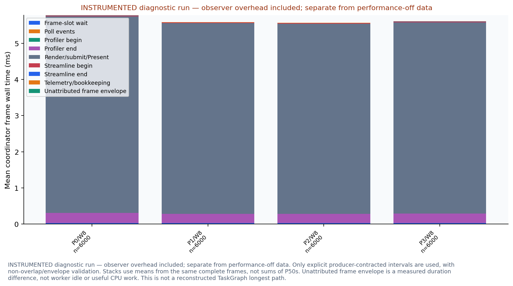

INSTRUMENTED diagnostic run — observer overhead included; separate from performance-off data. Only explicit producer-contracted intervals are used, with non-overlap/envelope validation. Stacks use means from the same complete frames, not sums of P50s. Unattributed frame envelope is a measured duration difference, not worker idle or useful CPU work. This is not a reconstructed TaskGraph longest path.

## Diagnostic DAG completion-chain breakdown

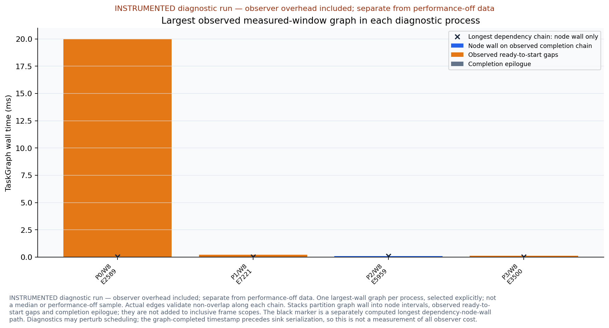

INSTRUMENTED diagnostic run — observer overhead included; separate from performance-off data. One largest-wall graph per process, selected explicitly; not a median or performance-off sample. Actual edges validate non-overlap along each chain. Stacks partition graph wall into node intervals, observed ready-to-start gaps and completion epilogue; they are not added to inclusive frame scopes. The black marker is a separately computed longest dependency-node-wall path. Diagnostics may perturb scheduling; the graph-completed timestamp precedes sink serialization, so this is not a measurement of all observer cost.

## Diagnostic worker intervals and actual DAG chain

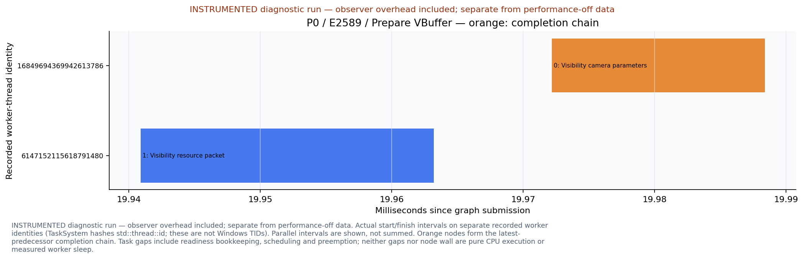

INSTRUMENTED diagnostic run — observer overhead included; separate from performance-off data. Actual start/finish intervals on separate recorded worker identities (TaskSystem hashes std::thread::id; these are not Windows TIDs). Parallel intervals are shown, not summed. Orange nodes form the latest-predecessor completion chain. Task gaps include readiness bookkeeping, scheduling and preemption; neither gaps nor node wall are pure CPU execution or measured worker sleep.

## Production memory and process-thread peaks

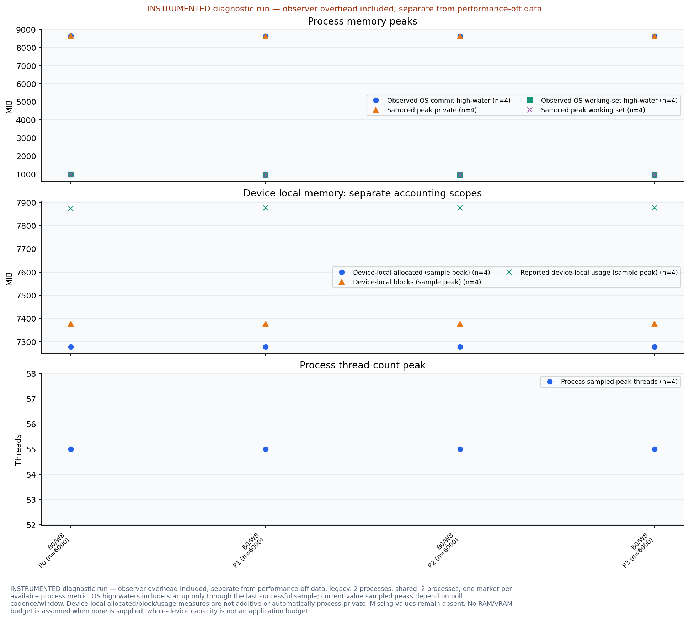

INSTRUMENTED diagnostic run — observer overhead included; separate from performance-off data. legacy: 2 processes, shared: 2 processes; one marker per available process metric. OS high-waters include startup only through the last successful sample; current-value sampled peaks depend on poll cadence/window. Device-local allocated/block/usage measures are not additive or automatically process-private. Missing values remain absent. No RAM/VRAM budget is assumed when none is supplied; whole-device capacity is not an application budget.

## Production RHI allocation high-waters

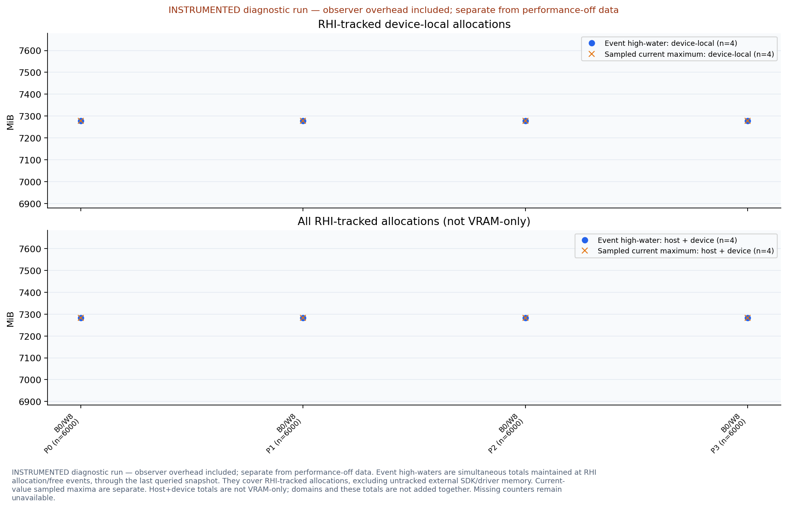

INSTRUMENTED diagnostic run — observer overhead included; separate from performance-off data. Event high-waters are simultaneous totals maintained at RHI allocation/free events, through the last queried snapshot. They cover RHI-tracked allocations, excluding untracked external SDK/driver memory. Current-value sampled maxima are separate. Host+device totals are not VRAM-only; domains and these totals are not added together. Missing counters remain unavailable.

## Production CPU occupancy

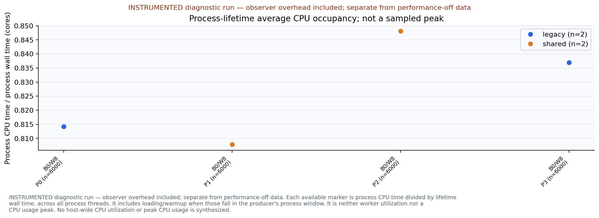

INSTRUMENTED diagnostic run — observer overhead included; separate from performance-off data. Each available marker is process CPU time divided by lifetime wall time, across all process threads. It includes loading/warmup when those fall in the producer's process window. It is neither worker utilization nor a CPU usage peak. No host-wide CPU utilization or peak CPU usage is synthesized.

## Production domain allocation peaks

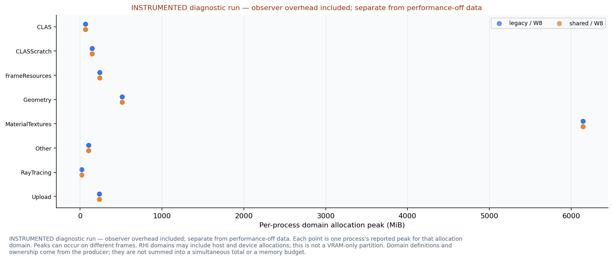

INSTRUMENTED diagnostic run — observer overhead included; separate from performance-off data. Each point is one process's reported peak for that allocation domain. Peaks can occur on different frames. RHI domains may include host and device allocations; this is not a VRAM-only partition. Domain definitions and ownership come from the producer; they are not summed into a simultaneous total or a memory budget.

## Initialization and loading scope observations

| Run | Block | Workers | Candidate | Editor initialization (console) (s) | Post-initialization to scene ready (capture) (s) | Process launch to exit (OS) (s) |
| --- | --- | --- | --- | --- | --- | --- |
| 0 | 0 | 8 | legacy | 3.357090 | 31.367375 | 74.212619 |
| 1 | 0 | 8 | shared | 3.406030 | 30.495857 | 71.972223 |
| 2 | 0 | 8 | shared | 3.135150 | 27.425893 | 68.865809 |
| 3 | 0 | 8 | legacy | 3.036370 | 27.655392 | 69.014215 |

## SceneLoad producer-owned step durations

| Run | Block | Workers | Candidate | Console occurrence | Owner step | Wall duration (ms) |
| --- | --- | --- | --- | --- | --- | --- |
| 0 | 0 | 8 | legacy | 1 | tinygltf file import | 39.20 |
| 0 | 0 | 8 | legacy | 2 | asset metadata, images, textures, and materials | 0.08 |
| 0 | 0 | 8 | legacy | 3 | scene graph traversal and primitive extraction | 0.58 |
| 1 | 0 | 8 | shared | 1 | tinygltf file import | 30.32 |
| 1 | 0 | 8 | shared | 2 | asset metadata, images, textures, and materials | 0.13 |
| 1 | 0 | 8 | shared | 3 | scene graph traversal and primitive extraction | 0.66 |
| 2 | 0 | 8 | shared | 1 | tinygltf file import | 36.34 |
| 2 | 0 | 8 | shared | 2 | asset metadata, images, textures, and materials | 0.07 |
| 2 | 0 | 8 | shared | 3 | scene graph traversal and primitive extraction | 0.51 |
| 3 | 0 | 8 | legacy | 1 | tinygltf file import | 30.16 |
| 3 | 0 | 8 | legacy | 2 | asset metadata, images, textures, and materials | 0.08 |
| 3 | 0 | 8 | legacy | 3 | scene graph traversal and primitive extraction | 0.55 |

## CPU scope-occurrence populations

| Scope path | Candidate | Workers | Available occurrences per process |
| --- | --- | --- | --- |
| Frame/Render Frame | legacy | 8 | P0: n=6000; P3: n=6000 |
| Frame/Render Frame | shared | 8 | P1: n=6000; P2: n=6000 |
| Frame | legacy | 8 | P0: n=6000; P3: n=6000 |
| Frame | shared | 8 | P1: n=6000; P2: n=6000 |
| Frame/Render Frame/Record RenderGraph | legacy | 8 | P0: n=6000; P3: n=6000 |
| Frame/Render Frame/Record RenderGraph | shared | 8 | P1: n=6000; P2: n=6000 |
| Frame/Render Frame/Record RenderGraph/RenderGraph Preview | legacy | 8 | P0: n=6000; P3: n=6000 |
| Frame/Render Frame/Record RenderGraph/RenderGraph Preview | shared | 8 | P1: n=6000; P2: n=6000 |
| Frame/Render Frame/Record RenderGraph/RenderGraph Preview/Graph preparation / Prior frame drain | legacy | 8 | P0: n=6000; P3: n=6000 |
| Frame/Render Frame/Record RenderGraph/RenderGraph Preview/Graph preparation / Prior frame drain | shared | 8 | P1: n=6000; P2: n=6000 |
| Frame/Render Frame/Record RenderGraph/RenderGraph Preview/RenderGraph GPU envelope | legacy | 8 | P0: n=6000; P3: n=6000 |
| Frame/Render Frame/Record RenderGraph/RenderGraph Preview/RenderGraph GPU envelope | shared | 8 | P1: n=6000; P2: n=6000 |
| Frame/Render Frame/Record RenderGraph/RenderGraph Preview/RenderGraph GPU envelope/VBuffer (VisibilityBufferPass) | legacy | 8 | P0: n=6000; P3: n=6000 |
| Frame/Render Frame/Record RenderGraph/RenderGraph Preview/RenderGraph GPU envelope/VBuffer (VisibilityBufferPass) | shared | 8 | P1: n=6000; P2: n=6000 |
| Frame/Render Frame/Record RenderGraph/RenderGraph Preview/RenderGraph GPU envelope/VBuffer (VisibilityBufferPass)/Stream traversal | legacy | 8 | P0: n=6000; P3: n=6000 |
| Frame/Render Frame/Record RenderGraph/RenderGraph Preview/RenderGraph GPU envelope/VBuffer (VisibilityBufferPass)/Stream traversal | shared | 8 | P1: n=6000; P2: n=6000 |
| Frame/Render Frame/Record RenderGraph/RenderGraph Preview/RenderGraph GPU envelope/VBuffer (VisibilityBufferPass)/Visibility raster | legacy | 8 | P0: n=6000; P3: n=6000 |
| Frame/Render Frame/Record RenderGraph/RenderGraph Preview/RenderGraph GPU envelope/VBuffer (VisibilityBufferPass)/Visibility raster | shared | 8 | P1: n=6000; P2: n=6000 |
| Frame/Render Frame/Record RenderGraph/RenderGraph Preview/RenderGraph GPU envelope/VBuffer (VisibilityBufferPass)/Visibility prepare | legacy | 8 | P0: n=6000; P3: n=6000 |
| Frame/Render Frame/Record RenderGraph/RenderGraph Preview/RenderGraph GPU envelope/VBuffer (VisibilityBufferPass)/Visibility prepare | shared | 8 | P1: n=6000; P2: n=6000 |
| Frame/Render Frame/Record RenderGraph/RenderGraph Preview/RenderGraph GPU envelope/DLSSSR (StreamlineDLSSSRPass) | legacy | 8 | P0: n=6000; P3: n=6000 |
| Frame/Render Frame/Record RenderGraph/RenderGraph Preview/RenderGraph GPU envelope/DLSSSR (StreamlineDLSSSRPass) | shared | 8 | P1: n=6000; P2: n=6000 |
| Frame/Render Frame/Record RenderGraph/RenderGraph Preview/RenderGraph GPU envelope/VBuffer (VisibilityBufferPass)/Stream traversal/RT representation classify | legacy | 8 | P0: n=6000; P3: n=6000 |
| Frame/Render Frame/Record RenderGraph/RenderGraph Preview/RenderGraph GPU envelope/VBuffer (VisibilityBufferPass)/Stream traversal/RT representation classify | shared | 8 | P1: n=6000; P2: n=6000 |
| Frame/Render Frame/Record RenderGraph/RenderGraph Preview/RenderGraph GPU envelope/Deferred (VisibilityBufferDeferredPass) | legacy | 8 | P0: n=6000; P3: n=6000 |
| Frame/Render Frame/Record RenderGraph/RenderGraph Preview/RenderGraph GPU envelope/Deferred (VisibilityBufferDeferredPass) | shared | 8 | P1: n=6000; P2: n=6000 |
| Frame/Render Frame/Record RenderGraph/RenderGraph Preview/Graph preparation / Refresh scene bindings | legacy | 8 | P0: n=6000; P3: n=6000 |
| Frame/Render Frame/Record RenderGraph/RenderGraph Preview/Graph preparation / Refresh scene bindings | shared | 8 | P1: n=6000; P2: n=6000 |
| Frame/Render Frame/Record RenderGraph/RenderGraph Preview/RenderGraph GPU envelope/Shadows (RayTracedShadowPass) | legacy | 8 | P0: n=6000; P3: n=6000 |
| Frame/Render Frame/Record RenderGraph/RenderGraph Preview/RenderGraph GPU envelope/Shadows (RayTracedShadowPass) | shared | 8 | P1: n=6000; P2: n=6000 |
| Frame/Render Frame/Record RenderGraph/RenderGraph Preview/RenderGraph GPU envelope/VBuffer (VisibilityBufferPass)/Stream traversal/RT representation cut | legacy | 8 | P0: n=6000; P3: n=6000 |
| Frame/Render Frame/Record RenderGraph/RenderGraph Preview/RenderGraph GPU envelope/VBuffer (VisibilityBufferPass)/Stream traversal/RT representation cut | shared | 8 | P1: n=6000; P2: n=6000 |

## Diagnostic graph selection

| Run | Workers | Candidate | Eligible graphs | Graph execution | Name | Nodes | Chain nodes | Graph wall ms |
| --- | --- | --- | --- | --- | --- | --- | --- | --- |
| 0 | 8 | legacy | 6000 | 2589 | Prepare VBuffer | 2 | 1 | 19.98950 |
| 1 | 8 | shared | 6000 | 7221 | Prepare VBuffer | 2 | 1 | 0.21100 |
| 2 | 8 | shared | 6000 | 5959 | Prepare VBuffer | 2 | 1 | 0.10290 |
| 3 | 8 | legacy | 6000 | 3500 | Prepare VBuffer | 2 | 1 | 0.11030 |

## Production comparison identity

| Candidate | Executable | SHA256 |
| --- | --- | --- |
| legacy | C:\Users\11252\.codex\worktrees\3379\metallic\build-issue73-production\Source\MetallicCPUJobsLegacy.exe | b19a266982b803b1363feeed446cfbc7d21c0b563faf9e9f8f4e7e89803c6142 |
| shared | C:\Users\11252\.codex\worktrees\3379\metallic\build-issue73-production\Source\Metallic.exe | 361d1651beb963a5c1418892bbe5e8695e2628c0c0eda8ce516640ef5caa8b67 |

## Production effective workload

| Workers | Scene | Graph | Camera | Output extent | Render extent | Recording limit | Validation |
| --- | --- | --- | --- | --- | --- | --- | --- |
| 8 | E:/metallic/Asset/SuperSponza/NewSponza_Main_glTF_003.gltf | [{'name': 'VBuffer', 'properties': {'asyncSoftwareRaster': False, 'autoBuildStreamAsset': False, 'autoLod': True, 'clasEmptyChunkRetentionFrames': 30, 'coldPageRetentionFrames': 120, 'compactClas': True, 'compactShadingAttributes': True, 'distributedDemandMinGroups': 65536, 'distributedPageDemand': True, 'enableClas': True, 'enableClusterRtx': True, 'growClasBytes': 67108864, 'hybridRaster': True, 'instanceFrustumCull': True, 'instanceHzbCull': True, 'lodPixelError': 1.5, 'materialTextureBudgetMiB': 8192, 'materialTextureColdFrames': 180, 'materialTextureMaskMaxDimension': 512, 'materialTextureMaxDimension': 128, 'materialTextureRefineDimension': 512, 'maxActiveGroups': 1048575, 'maxBlasBytes': 536870912, 'maxClasBuildClusters': 8192, 'maxClasBytes': 2147483648, 'maxGpuPageRequests': 65536, 'maxGpuPageUnloadRequests': 65536, 'maxLockedFallbackPages': 65536, 'maxPageLoadsInFlight': 1024, 'maxPageUploadsPerFrame': 256, 'maxRasterCandidates': 8388608, 'maxResidentBytes': 536870912, 'maxResidentPages': 0, 'maxTraversalWorkItems': 1048576, 'maxTraversalWorkers': 4096, 'maxUploadBytesPerFrame': 8388608, 'meshletFrustumCull': True, 'meshletNormalConeCull': False, 'pageLoadConcurrency': 4, 'path': 'E:/metallic/Asset/SuperSponza/NewSponza_Main_glTF_003.gltf', 'persistentClasGrowBytes': 33554432, 'sceneBinding': 'asset', 'startClasBytes': 0, 'streamAssetPath': 'E:/metallic/Asset/SuperSponza/NewSponza_Main_glTF_003.gltf.meshstream.bin', 'viewBinding': 'global', 'visualization': 'none'}, 'type': 'VisibilityBufferPass'}, {'name': 'Shadows', 'properties': {'materialTextureBudgetMiB': 8192, 'materialTextureColdFrames': 180, 'materialTextureMaskMaxDimension': 512, 'materialTextureMaxDimension': 128, 'materialTextureRefineDimension': 512, 'path': 'E:/metallic/Asset/SuperSponza/NewSponza_Main_glTF_003.gltf', 'rayTracedShadows': True, 'shadowBias': 0.01, 'shadowLightIndex': -1, 'shadowLightRadius': 0.05, 'shadowRayLength': 100000.0, 'sigmaDenoise': True, 'sigmaHistoryLength': 5}, 'type': 'RayTracedShadowPass'}, {'name': 'Deferred', 'properties': {'exportUpscalerGuides': True, 'materialBinning': True, 'materialTextureBudgetMiB': 8192, 'materialTextureColdFrames': 180, 'materialTextureMaskMaxDimension': 512, 'materialTextureMaxDimension': 128, 'materialTextureRefineDimension': 512, 'outputLinear': True, 'path': 'E:/metallic/Asset/SuperSponza/NewSponza_Main_glTF_003.gltf'}, 'type': 'VisibilityBufferDeferredPass'}, {'name': 'DLSSSR', 'properties': {'exportOutputGuides': True, 'mode': 'Quality'}, 'type': 'StreamlineDLSSSRPass'}, {'name': 'AutoExposure', 'properties': {}, 'type': 'AutoExposurePass'}, {'name': 'DLSSNR', 'properties': {'enabled': False, 'fallbackToInput': True, 'intensity': 1.0, 'preset': 0, 'style': 0}, 'type': 'DLSSNRPass'}, {'name': 'FinalBlit', 'properties': {}, 'type': 'FinalBlitPass'}, {'name': 'ColorGrading', 'properties': {'toneCurve': 'aces2'}, 'type': 'ColorGradingLUTPass'}] | {'center': [-7.84351921081543, 1.786533236503601, -0.6762740612030029], 'eye': [-8.807430267333984, 1.5922194719314575, -0.8582578301429749], 'fovDegrees': 58.51197814941406, 'orthoHeight': 2.0, 'projection': 'perspective', 'up': [-0.19094055891036987, 0.9809394478797913, -0.03604902699589729], 'zfar': 10000.0, 'znear': 0.10000000149011612} | [1920, 1080] | [1280, 720] | 8 | False |

## Production process populations

| Run | Block | Workers | Candidate | Measured frames | Frame P50 ms | Frame P95 ms | Frame P99 ms |
| --- | --- | --- | --- | --- | --- | --- | --- |
| 0 | 0 | 8 | legacy | 6000 | 5.6743 | 6.5116 | 7.1513 |
| 1 | 0 | 8 | shared | 6000 | 5.5434 | 6.0628 | 6.2970 |
| 2 | 0 | 8 | shared | 6000 | 5.5293 | 6.0538 | 6.2821 |
| 3 | 0 | 8 | legacy | 6000 | 5.5479 | 6.1393 | 6.6745 |

[Input and plot provenance](PlotManifest.json)
