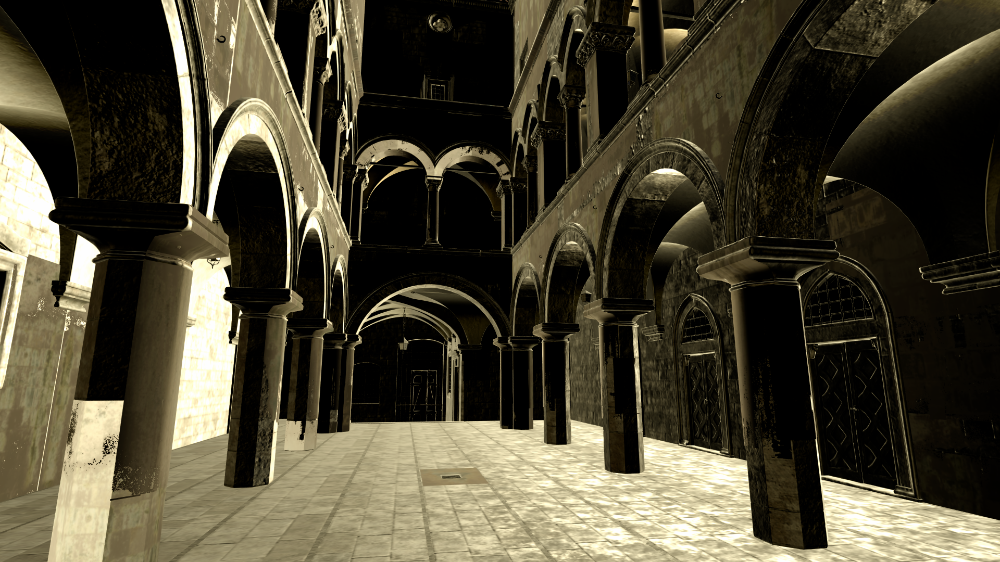
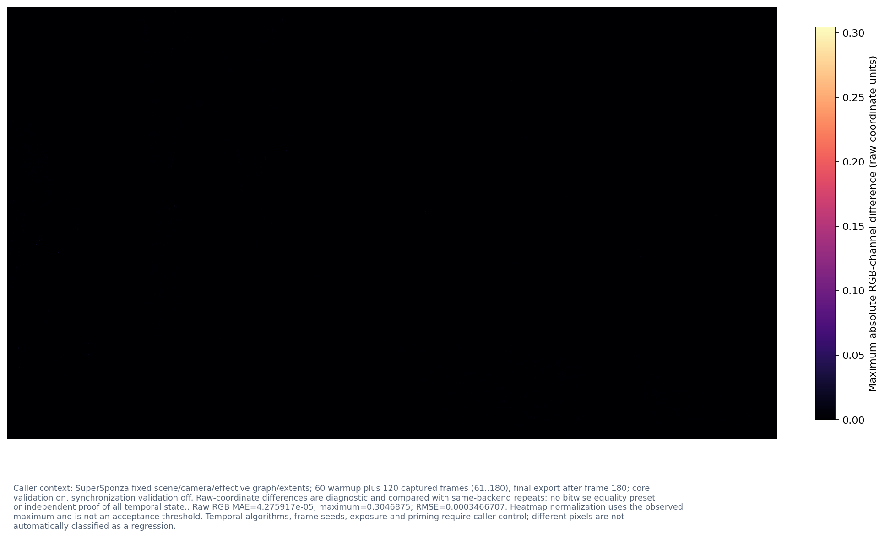

# SuperSponza validation image diagnostic: Shared2Legacy3

Generated from immutable evidence; no renderer or benchmark was executed.

- P50/P95/P99 summarize the recorded sample population, not confidence intervals. Missing data is never replaced with zero.
- Budgets: frameMs=not supplied; cpuMemoryMiB=not supplied; vramMiB=not supplied

## Render output preview 1

Native 1920x1080 RGB preview from RGBA16Sfloat; encoding enum=2; preview transfer=linear-rec709, fixed clipping to raw [0,1], alpha ignored for display but checked for finiteness. No adaptive exposure or tone mapping. SceneLinear/ExposedLinear basis is not guessed; HDR values outside the clipping interval remain in raw statistics.

## Render output preview 2

Native 1920x1080 RGB preview from RGBA16Sfloat; encoding enum=2; preview transfer=linear-rec709, fixed clipping to raw [0,1], alpha ignored for display but checked for finiteness. No adaptive exposure or tone mapping. SceneLinear/ExposedLinear basis is not guessed; HDR values outside the clipping interval remain in raw statistics.

## Render output numerical comparison

Caller context: SuperSponza fixed scene/camera/effective graph/extents; 60 warmup plus 120 captured frames (61..180), final export after frame 180; core validation on, synchronization validation off. Raw-coordinate differences are diagnostic and compared with same-backend repeats; no bitwise equality preset or independent proof of all temporal state.. Raw RGB MAE=4.275917e-05; maximum=0.3046875; RMSE=0.0003466707. Heatmap normalization uses the observed maximum and is not an acceptance threshold. Temporal algorithms, frame seeds, exposure and priming require caller control; different pixels are not automatically classified as a regression.

[Input and plot provenance](PlotManifest.json)
