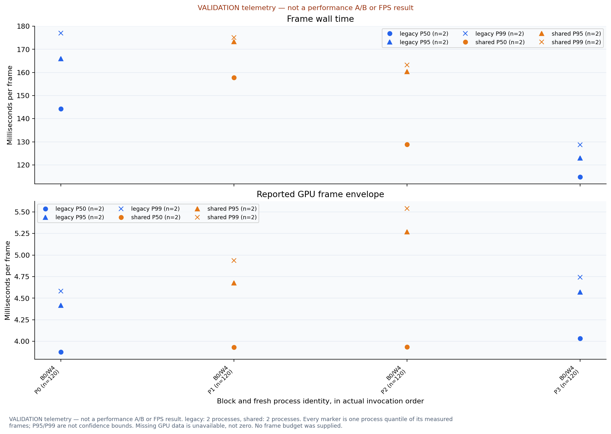
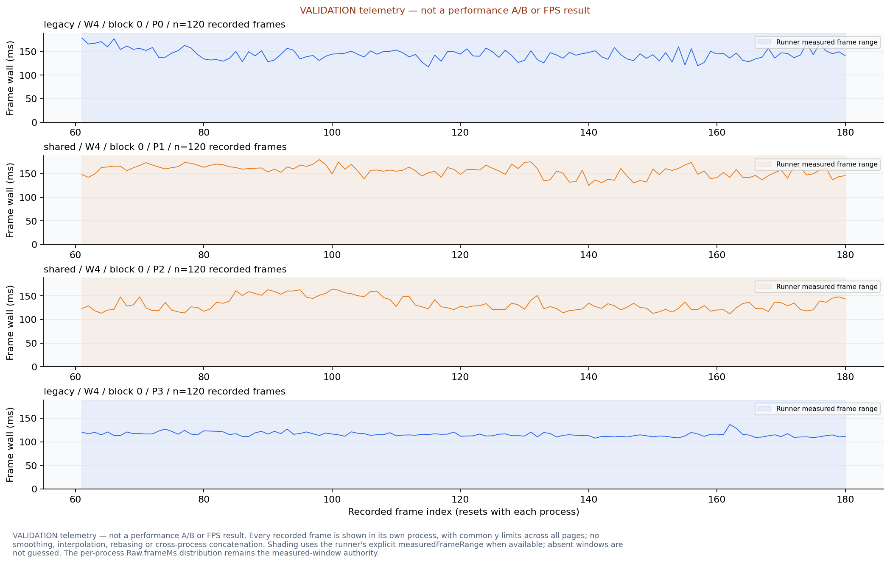
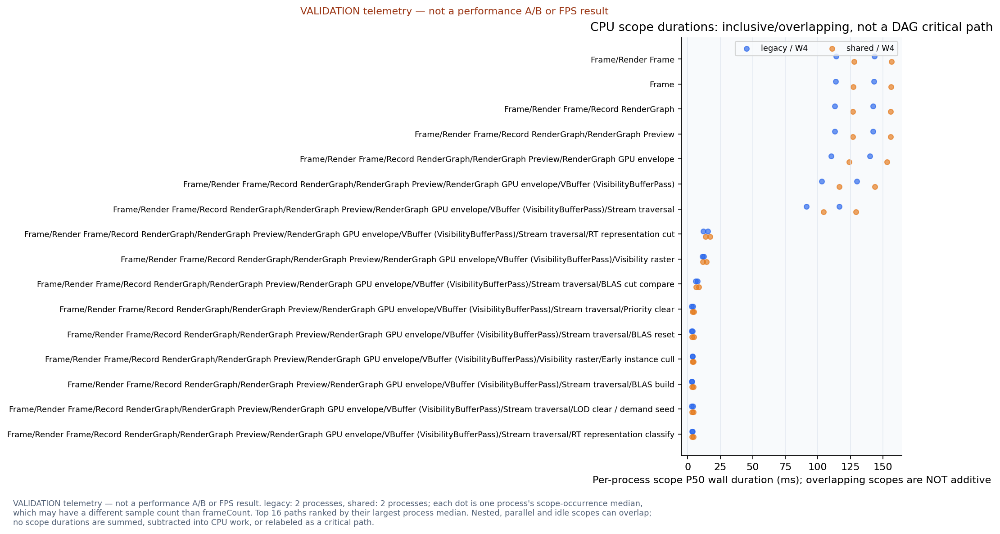
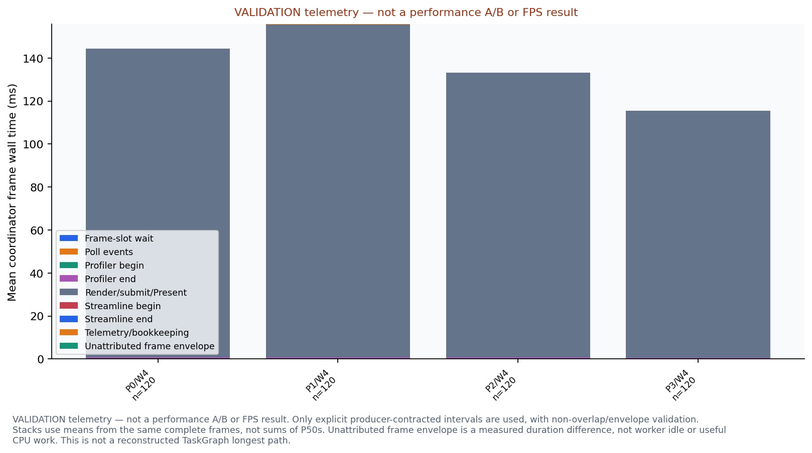
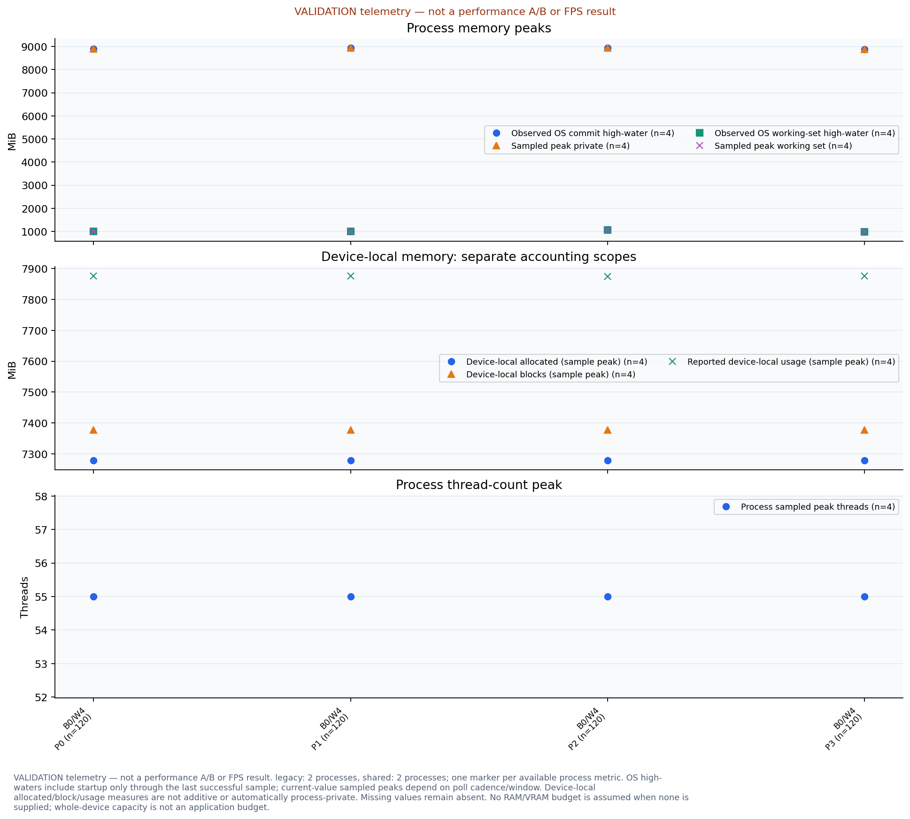
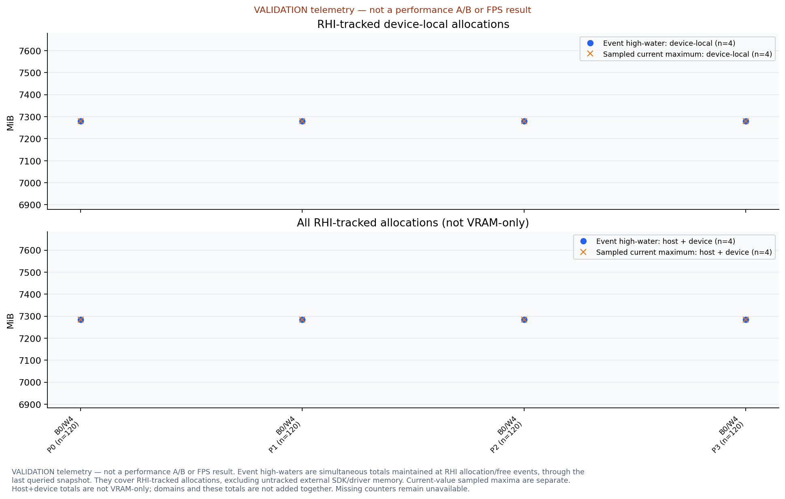
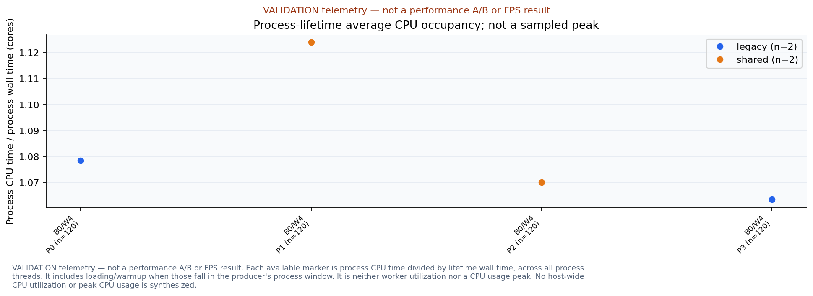
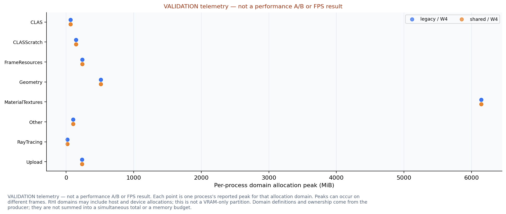
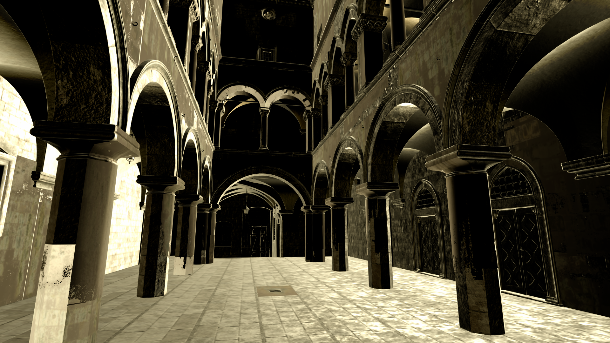

# SuperSponza validation ABBA: instrumented correctness telemetry, not FPS

Generated from immutable evidence; no renderer or benchmark was executed.

- P50/P95/P99 summarize the recorded sample population, not confidence intervals. Missing data is never replaced with zero.
- Budgets: frameMs=not supplied; cpuMemoryMiB=not supplied; vramMiB=not supplied
- Production input purpose=validation; scheduling diagnostics=on; app diagnostic sink=True. Validation and performance populations are not mixed.
- Production: 4 passed measured processes; 0 prewarm/failed/incomplete records excluded from latency comparisons. Frames are correlated within a process; per-process quantiles are plotted individually, never pooled as independent experiments.
- Production worker limits: [4]; W labels identify each limit. No results are averaged across different worker limits, blocks or executable candidates.
- A TaskGraph/DAG critical path is unavailable unless dependency-linked task intervals are separately recorded. Inclusive profiler scope durations alone do not establish that path.
- No dependency-linked TaskGraph intervals inside a measured frame window: DAG completion-chain plots unavailable. Diagnostic sink runs are separate from performance-off captures.

## Production frame distributions by process/block

VALIDATION telemetry — not a performance A/B or FPS result. legacy: 2 processes, shared: 2 processes. Every marker is one process quantile of its measured frames; P95/P99 are not confidence bounds. Missing GPU data is unavailable, not zero. No frame budget was supplied.

## Production recorded frame time series, page 1

VALIDATION telemetry — not a performance A/B or FPS result. Every recorded frame is shown in its own process, with common y limits across all pages; no smoothing, interpolation, rebasing or cross-process concatenation. Shading uses the runner's explicit measuredFrameRange when available; absent windows are not guessed. The per-process Raw.frameMs distribution remains the measured-window authority.

## Production CPU scope wall durations

VALIDATION telemetry — not a performance A/B or FPS result. legacy: 2 processes, shared: 2 processes; each dot is one process's scope-occurrence median, which may have a different sample count than frameCount. Top 16 paths ranked by their largest process median. Nested, parallel and idle scopes can overlap; no scope durations are summed, subtracted into CPU work, or relabeled as a critical path.

## Production non-overlapping coordinator frame path

VALIDATION telemetry — not a performance A/B or FPS result. Only explicit producer-contracted intervals are used, with non-overlap/envelope validation. Stacks use means from the same complete frames, not sums of P50s. Unattributed frame envelope is a measured duration difference, not worker idle or useful CPU work. This is not a reconstructed TaskGraph longest path.

## Production memory and process-thread peaks

VALIDATION telemetry — not a performance A/B or FPS result. legacy: 2 processes, shared: 2 processes; one marker per available process metric. OS high-waters include startup only through the last successful sample; current-value sampled peaks depend on poll cadence/window. Device-local allocated/block/usage measures are not additive or automatically process-private. Missing values remain absent. No RAM/VRAM budget is assumed when none is supplied; whole-device capacity is not an application budget.

## Production RHI allocation high-waters

VALIDATION telemetry — not a performance A/B or FPS result. Event high-waters are simultaneous totals maintained at RHI allocation/free events, through the last queried snapshot. They cover RHI-tracked allocations, excluding untracked external SDK/driver memory. Current-value sampled maxima are separate. Host+device totals are not VRAM-only; domains and these totals are not added together. Missing counters remain unavailable.

## Production CPU occupancy

VALIDATION telemetry — not a performance A/B or FPS result. Each available marker is process CPU time divided by lifetime wall time, across all process threads. It includes loading/warmup when those fall in the producer's process window. It is neither worker utilization nor a CPU usage peak. No host-wide CPU utilization or peak CPU usage is synthesized.

## Production domain allocation peaks

VALIDATION telemetry — not a performance A/B or FPS result. Each point is one process's reported peak for that allocation domain. Peaks can occur on different frames. RHI domains may include host and device allocations; this is not a VRAM-only partition. Domain definitions and ownership come from the producer; they are not summed into a simultaneous total or a memory budget.

## Render output preview 1

Native 1920x1080 RGB preview from RGBA16Sfloat; encoding enum=2; preview transfer=linear-rec709, fixed clipping to raw [0,1], alpha ignored for display but checked for finiteness. No adaptive exposure or tone mapping. SceneLinear/ExposedLinear basis is not guessed; HDR values outside the clipping interval remain in raw statistics.

## Render output preview 2

Native 1920x1080 RGB preview from RGBA16Sfloat; encoding enum=2; preview transfer=linear-rec709, fixed clipping to raw [0,1], alpha ignored for display but checked for finiteness. No adaptive exposure or tone mapping. SceneLinear/ExposedLinear basis is not guessed; HDR values outside the clipping interval remain in raw statistics.

## Render output preview 3

Native 1920x1080 RGB preview from RGBA16Sfloat; encoding enum=2; preview transfer=linear-rec709, fixed clipping to raw [0,1], alpha ignored for display but checked for finiteness. No adaptive exposure or tone mapping. SceneLinear/ExposedLinear basis is not guessed; HDR values outside the clipping interval remain in raw statistics.

## Render output preview 4

Native 1920x1080 RGB preview from RGBA16Sfloat; encoding enum=2; preview transfer=linear-rec709, fixed clipping to raw [0,1], alpha ignored for display but checked for finiteness. No adaptive exposure or tone mapping. SceneLinear/ExposedLinear basis is not guessed; HDR values outside the clipping interval remain in raw statistics.

## CPU scope-occurrence populations

| Scope path | Candidate | Workers | Available occurrences per process |
| --- | --- | --- | --- |
| Frame/Render Frame | legacy | 4 | P0: n=120; P3: n=120 |
| Frame/Render Frame | shared | 4 | P1: n=120; P2: n=120 |
| Frame | legacy | 4 | P0: n=120; P3: n=120 |
| Frame | shared | 4 | P1: n=120; P2: n=120 |
| Frame/Render Frame/Record RenderGraph | legacy | 4 | P0: n=120; P3: n=120 |
| Frame/Render Frame/Record RenderGraph | shared | 4 | P1: n=120; P2: n=120 |
| Frame/Render Frame/Record RenderGraph/RenderGraph Preview | legacy | 4 | P0: n=120; P3: n=120 |
| Frame/Render Frame/Record RenderGraph/RenderGraph Preview | shared | 4 | P1: n=120; P2: n=120 |
| Frame/Render Frame/Record RenderGraph/RenderGraph Preview/RenderGraph GPU envelope | legacy | 4 | P0: n=120; P3: n=120 |
| Frame/Render Frame/Record RenderGraph/RenderGraph Preview/RenderGraph GPU envelope | shared | 4 | P1: n=120; P2: n=120 |
| Frame/Render Frame/Record RenderGraph/RenderGraph Preview/RenderGraph GPU envelope/VBuffer (VisibilityBufferPass) | legacy | 4 | P0: n=120; P3: n=120 |
| Frame/Render Frame/Record RenderGraph/RenderGraph Preview/RenderGraph GPU envelope/VBuffer (VisibilityBufferPass) | shared | 4 | P1: n=120; P2: n=120 |
| Frame/Render Frame/Record RenderGraph/RenderGraph Preview/RenderGraph GPU envelope/VBuffer (VisibilityBufferPass)/Stream traversal | legacy | 4 | P0: n=120; P3: n=120 |
| Frame/Render Frame/Record RenderGraph/RenderGraph Preview/RenderGraph GPU envelope/VBuffer (VisibilityBufferPass)/Stream traversal | shared | 4 | P1: n=120; P2: n=120 |
| Frame/Render Frame/Record RenderGraph/RenderGraph Preview/RenderGraph GPU envelope/VBuffer (VisibilityBufferPass)/Stream traversal/RT representation cut | legacy | 4 | P0: n=120; P3: n=120 |
| Frame/Render Frame/Record RenderGraph/RenderGraph Preview/RenderGraph GPU envelope/VBuffer (VisibilityBufferPass)/Stream traversal/RT representation cut | shared | 4 | P1: n=120; P2: n=120 |
| Frame/Render Frame/Record RenderGraph/RenderGraph Preview/RenderGraph GPU envelope/VBuffer (VisibilityBufferPass)/Visibility raster | legacy | 4 | P0: n=120; P3: n=120 |
| Frame/Render Frame/Record RenderGraph/RenderGraph Preview/RenderGraph GPU envelope/VBuffer (VisibilityBufferPass)/Visibility raster | shared | 4 | P1: n=120; P2: n=120 |
| Frame/Render Frame/Record RenderGraph/RenderGraph Preview/RenderGraph GPU envelope/VBuffer (VisibilityBufferPass)/Stream traversal/BLAS cut compare | legacy | 4 | P0: n=120; P3: n=120 |
| Frame/Render Frame/Record RenderGraph/RenderGraph Preview/RenderGraph GPU envelope/VBuffer (VisibilityBufferPass)/Stream traversal/BLAS cut compare | shared | 4 | P1: n=120; P2: n=120 |
| Frame/Render Frame/Record RenderGraph/RenderGraph Preview/RenderGraph GPU envelope/VBuffer (VisibilityBufferPass)/Stream traversal/Priority clear | legacy | 4 | P0: n=120; P3: n=120 |
| Frame/Render Frame/Record RenderGraph/RenderGraph Preview/RenderGraph GPU envelope/VBuffer (VisibilityBufferPass)/Stream traversal/Priority clear | shared | 4 | P1: n=120; P2: n=120 |
| Frame/Render Frame/Record RenderGraph/RenderGraph Preview/RenderGraph GPU envelope/VBuffer (VisibilityBufferPass)/Stream traversal/BLAS reset | legacy | 4 | P0: n=120; P3: n=120 |
| Frame/Render Frame/Record RenderGraph/RenderGraph Preview/RenderGraph GPU envelope/VBuffer (VisibilityBufferPass)/Stream traversal/BLAS reset | shared | 4 | P1: n=120; P2: n=120 |
| Frame/Render Frame/Record RenderGraph/RenderGraph Preview/RenderGraph GPU envelope/VBuffer (VisibilityBufferPass)/Visibility raster/Early instance cull | legacy | 4 | P0: n=120; P3: n=120 |
| Frame/Render Frame/Record RenderGraph/RenderGraph Preview/RenderGraph GPU envelope/VBuffer (VisibilityBufferPass)/Visibility raster/Early instance cull | shared | 4 | P1: n=120; P2: n=120 |
| Frame/Render Frame/Record RenderGraph/RenderGraph Preview/RenderGraph GPU envelope/VBuffer (VisibilityBufferPass)/Stream traversal/BLAS build | legacy | 4 | P0: n=120; P3: n=120 |
| Frame/Render Frame/Record RenderGraph/RenderGraph Preview/RenderGraph GPU envelope/VBuffer (VisibilityBufferPass)/Stream traversal/BLAS build | shared | 4 | P1: n=120; P2: n=120 |
| Frame/Render Frame/Record RenderGraph/RenderGraph Preview/RenderGraph GPU envelope/VBuffer (VisibilityBufferPass)/Stream traversal/LOD clear / demand seed | legacy | 4 | P0: n=120; P3: n=120 |
| Frame/Render Frame/Record RenderGraph/RenderGraph Preview/RenderGraph GPU envelope/VBuffer (VisibilityBufferPass)/Stream traversal/LOD clear / demand seed | shared | 4 | P1: n=120; P2: n=120 |
| Frame/Render Frame/Record RenderGraph/RenderGraph Preview/RenderGraph GPU envelope/VBuffer (VisibilityBufferPass)/Stream traversal/RT representation classify | legacy | 4 | P0: n=120; P3: n=120 |
| Frame/Render Frame/Record RenderGraph/RenderGraph Preview/RenderGraph GPU envelope/VBuffer (VisibilityBufferPass)/Stream traversal/RT representation classify | shared | 4 | P1: n=120; P2: n=120 |

## Production comparison identity

| Candidate | Executable | SHA256 |
| --- | --- | --- |
| legacy | C:\Users\11252\.codex\worktrees\3379\metallic\build-issue73-production\Source\MetallicCPUJobsLegacy.exe | b19a266982b803b1363feeed446cfbc7d21c0b563faf9e9f8f4e7e89803c6142 |
| shared | C:\Users\11252\.codex\worktrees\3379\metallic\build-issue73-production\Source\Metallic.exe | 361d1651beb963a5c1418892bbe5e8695e2628c0c0eda8ce516640ef5caa8b67 |

## Production effective workload

| Workers | Scene | Graph | Camera | Output extent | Render extent | Recording limit | Validation |
| --- | --- | --- | --- | --- | --- | --- | --- |
| 4 | E:/metallic/Asset/SuperSponza/NewSponza_Main_glTF_003.gltf | [{'name': 'VBuffer', 'properties': {'asyncSoftwareRaster': False, 'autoBuildStreamAsset': False, 'autoLod': True, 'clasEmptyChunkRetentionFrames': 30, 'coldPageRetentionFrames': 120, 'compactClas': True, 'compactShadingAttributes': True, 'distributedDemandMinGroups': 65536, 'distributedPageDemand': True, 'enableClas': True, 'enableClusterRtx': True, 'growClasBytes': 67108864, 'hybridRaster': True, 'instanceFrustumCull': True, 'instanceHzbCull': True, 'lodPixelError': 1.5, 'materialTextureBudgetMiB': 8192, 'materialTextureColdFrames': 180, 'materialTextureMaskMaxDimension': 512, 'materialTextureMaxDimension': 128, 'materialTextureRefineDimension': 512, 'maxActiveGroups': 1048575, 'maxBlasBytes': 536870912, 'maxClasBuildClusters': 8192, 'maxClasBytes': 2147483648, 'maxGpuPageRequests': 65536, 'maxGpuPageUnloadRequests': 65536, 'maxLockedFallbackPages': 65536, 'maxPageLoadsInFlight': 1024, 'maxPageUploadsPerFrame': 256, 'maxRasterCandidates': 8388608, 'maxResidentBytes': 536870912, 'maxResidentPages': 0, 'maxTraversalWorkItems': 1048576, 'maxTraversalWorkers': 4096, 'maxUploadBytesPerFrame': 8388608, 'meshletFrustumCull': True, 'meshletNormalConeCull': False, 'pageLoadConcurrency': 4, 'path': 'E:/metallic/Asset/SuperSponza/NewSponza_Main_glTF_003.gltf', 'persistentClasGrowBytes': 33554432, 'sceneBinding': 'asset', 'startClasBytes': 0, 'streamAssetPath': 'E:/metallic/Asset/SuperSponza/NewSponza_Main_glTF_003.gltf.meshstream.bin', 'viewBinding': 'global', 'visualization': 'none'}, 'type': 'VisibilityBufferPass'}, {'name': 'Shadows', 'properties': {'materialTextureBudgetMiB': 8192, 'materialTextureColdFrames': 180, 'materialTextureMaskMaxDimension': 512, 'materialTextureMaxDimension': 128, 'materialTextureRefineDimension': 512, 'path': 'E:/metallic/Asset/SuperSponza/NewSponza_Main_glTF_003.gltf', 'rayTracedShadows': True, 'shadowBias': 0.01, 'shadowLightIndex': -1, 'shadowLightRadius': 0.05, 'shadowRayLength': 100000.0, 'sigmaDenoise': True, 'sigmaHistoryLength': 5}, 'type': 'RayTracedShadowPass'}, {'name': 'Deferred', 'properties': {'exportUpscalerGuides': True, 'materialBinning': True, 'materialTextureBudgetMiB': 8192, 'materialTextureColdFrames': 180, 'materialTextureMaskMaxDimension': 512, 'materialTextureMaxDimension': 128, 'materialTextureRefineDimension': 512, 'outputLinear': True, 'path': 'E:/metallic/Asset/SuperSponza/NewSponza_Main_glTF_003.gltf'}, 'type': 'VisibilityBufferDeferredPass'}, {'name': 'DLSSSR', 'properties': {'exportOutputGuides': True, 'mode': 'Quality'}, 'type': 'StreamlineDLSSSRPass'}, {'name': 'AutoExposure', 'properties': {}, 'type': 'AutoExposurePass'}, {'name': 'DLSSNR', 'properties': {'enabled': False, 'fallbackToInput': True, 'intensity': 1.0, 'preset': 0, 'style': 0}, 'type': 'DLSSNRPass'}, {'name': 'FinalBlit', 'properties': {}, 'type': 'FinalBlitPass'}, {'name': 'ColorGrading', 'properties': {'toneCurve': 'aces2'}, 'type': 'ColorGradingLUTPass'}] | {'center': [-7.84351921081543, 1.786533236503601, -0.6762740612030029], 'eye': [-8.807430267333984, 1.5922194719314575, -0.8582578301429749], 'fovDegrees': 58.51197814941406, 'orthoHeight': 2.0, 'projection': 'perspective', 'up': [-0.19094055891036987, 0.9809394478797913, -0.03604902699589729], 'zfar': 10000.0, 'znear': 0.10000000149011612} | [1920, 1080] | [1280, 720] | 4 | True |

## Production process populations

| Run | Block | Workers | Candidate | Measured frames | Frame P50 ms | Frame P95 ms | Frame P99 ms |
| --- | --- | --- | --- | --- | --- | --- | --- |
| 0 | 0 | 4 | legacy | 120 | 144.2198 | 165.9381 | 176.9683 |
| 1 | 0 | 4 | shared | 120 | 157.7198 | 173.3593 | 175.0764 |
| 2 | 0 | 4 | shared | 120 | 128.7909 | 160.4291 | 163.2325 |
| 3 | 0 | 4 | legacy | 120 | 114.8358 | 122.9584 | 128.7409 |

[Input and plot provenance](PlotManifest.json)
