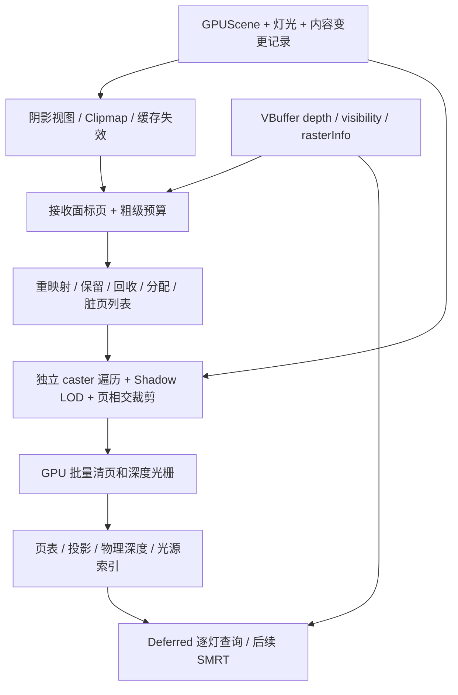

# Metallic 默认 Virtual Shadow Maps 调研与实施方案

调研日期：2026-10-22。Metallic 基线：`9c38bc4581d129b8ff2c42a0110db4828bb9fac4`。

本文是设计建议，尚未实现 VSM，也没有新的 GPU 画质或性能结果。结论来自当前 Metallic 源码、本机 UE 源码及 Epic 官方资料；历史文档只作为检索线索，冲突时以当前代码为准。

## 1. 建议与范围

建议为 **Metallic 实时光栅 / VisibilityBuffer Deferred 路径**建立 UE 风格的 VSM 默认阴影后端：采用按需虚拟页、方向光 clipmap、持久物理页池、精确失效、GPU 批量 caster 光栅，随后加入 SMRT。复用 Metallic 的 GPUScene、meshlet、材质 Coverage、流送和 RenderGraph；在 C++23 / Slang / Vulkan 中独立实现相应机制。

“默认”应指新建实时图及实时 sample 的默认阴影选择，不是将所有光照路径改为 VSM。`Pipelines/default.metallic_graph.json` 当前是 `PathTracingSample`；它和 RTXDI / PT 的几何可见性、RGB 透射阴影继续保留。已有保存图中的显式 `RayTracedShadowPass` 也保持其语义。

推荐次序：**底层光栅验证 → 单太阳硬阴影闭环 → Sun/Moon 与缓存 → 点光/聚光与多灯接口 → SMRT 与内容兼容 → 默认切换**。不要以“单灯可以出图”作为默认切换完成的标准。

本机 UE `Engine/Build/Build.version` 标记 **5.7.4**，`CompatibleChangelist=47537391`、`Changelist=0`；未确认该检出的 Git commit，因此不将它称为已认证的官方发行提交。在线 VSM 页面当前标记为 5.8，本文将其作为概念参考；细节以本机 5.7.4 源码锚点为准。

实现方式上区分“学习算法并独立实现”和“复制 UE 源码”：Epic 的[源码 FAQ](https://www.unrealengine.com/ue-on-github?lang=en-US)明确区分两者，并说明复制代码会涉及 UE EULA。本方案采用前者，不把 UE shader 参考文件加入 Metallic 生产源码。

## 2. 当前仓库适配性

| 已核实的现状 | 对方案的影响 | 代码入口 |
| --- | --- | --- |
| realtime graph 使用独立 `RayTracedShadowPass`，文件仍叫 ScreenSpaceShadows | 当前基线是 TLAS + SIGMA，不是屏幕空间 ray march | `Pipelines/Samples/realtime_lighting.metallic_graph.json:23`；`Source/Runtime/Render/RenderPass/BuiltinPass/ScreenSpaceShadowPass.cpp` |
| 阴影 ABI 为一张 R8 可见度和一个 320 B 参数块，读取时将 sqrt 编码平方，只作用于指定光源 | 不能只替换 producer 就宣称支持多灯 VSM；必须新增逐灯资源契约 | `Source/Runtime/Render/ScreenSpaceShadows.h:27`；`Shaders/Modules/VisibilityBufferLighting.slang:135` |
| Deferred 无阴影输入时按无遮挡处理，shader 不执行 ray query | VSM 资源须由图显式提供；保持 raster-only 边界 | `Source/Runtime/Render/RenderPass/BuiltinPass/ScenePathTracePass.cpp:1724`；`Documentation/VisibilityBufferDeferred.md:48` |
| Sun/Moon 为固定两槽，方向、角半径与 local lights 分域 | 方向光先覆盖 Sun/Moon；不用新增一种混进 LightGrid 的通用方向灯 | `Source/Runtime/Render/Environment/CelestialLighting.h:16` |
| GPUScene 有 generation/revision、独立 view 和 frame slots | 可以复用所有权、视图和资源调度，但还需 shadow 专用内容变更事件 | `Source/Runtime/Render/Subsystem/GPUScene.h:278`、`:431`、`:539` |
| GPUDriven 已有 cluster/meshlet、LOD、GPU 工作分箱和 indirect raster | 具备高效 VSM caster 路线的基础；仍需独立光源视图的遍历与页裁剪 | `Source/Runtime/Render/RenderPass/BuiltinPass/VisibilityBufferPass.cpp` |
| MeshletStreamFrameDesc 仍以单个 culling/render camera 为入口；Deferred 借用当前 producer 的几何快照 | 主视图 visible cluster/cut 不能充当阴影 caster 集；要扩展多视图需求合并 | `Source/Runtime/Render/Streamer/MeshletStreamRuntime.h:567`、`:656` |
| Coverage 已独立于完整 Surface/Closure 计算 | MASK/custom Coverage 可复用，不需要在深度 pass 求整个 OpenPBR | `Shaders/Modules/Material/Coverage.slang:61` |
| 云阴影已经进入太阳/月亮 irradiance | VSM 只再乘几何可见性，避免重复乘云透射 | `Shaders/Modules/Lighting/EnvironmentTransport.slang:34` |

需要避免两处历史误读：`Documentation/ScreenSpaceShadows.md` 仍保留“Deferred 内部补光追”的旧说法，与当前源码不符；较早的 GPUDriven 审计把 shadow pass 的 frame-overlap 描述为恒 false，当前实现是 `!METALLIC_HAS_NRD`。本次不顺带修改这些历史资料。

## 3. 从 UE 保留哪些机制

Epic 的[官方 VSM 概述](https://dev.epicgames.com/documentation/en-us/unreal-engine/virtual-shadow-maps-in-unreal-engine)说明：16K 虚拟分辨率、128×128 页、屏幕接收面按需标页、跨帧缓存；方向光使用 clipmap，SMRT 在深度图上采样得到接触硬化软阴影。其效果和成本依赖高效几何裁剪、缓存命中及投影采样，不只是较大的 shadow map。

下列细节已对照本机源码；它们是设计依据，不代表要照搬 UE ABI 或常量。

| 机制 | 必须保留的约束 | 本机 UE 锚点（相对 `E:/UnrealEngine/Engine/`） |
| --- | --- | --- |
| Clipmap 缓存 | XY 对齐页网格，以整数页偏移重映射；保持缓存 Z 映射，超出 guard band 才失效。不能每帧重新 fit Z 后继续读旧深度 | `Source/Runtime/Renderer/Private/VirtualShadowMaps/VirtualShadowMapClipmap.cpp:340`；`VirtualShadowMapCacheManager.cpp:202` |
| 失效 | 变更前处理旧 bounds / 删除，变更后处理新 bounds / 添加；移动只处理新位置会留下旧阴影 | `VirtualShadowMapCacheManager.cpp:2083`、`:2210` |
| 页回收 | 回收物理页时清旧 owner 映射；空闲/驻留页不能丢失或重复归属；分配失败不产生有效映射 | `Shaders/Private/VirtualShadowMaps/VirtualShadowMapPhysicalPageManagement.usf:425`、`:688` |
| Receiver mask | 部分页与完整页有不同缓存语义。UE mask 裁剪动态 caster 后，该动态页每帧重画；静态 caster 不按 mask 裁剪 | `Shaders/Private/VirtualShadowMaps/VirtualShadowMapPhysicalPageManagement.usf:333`；`Shaders/Private/Nanite/NaniteClusterCulling.usf:514` |
| 粗级查询 | mip 页表传播可用的粗一级映射；方向光跨 clipmap 另按目标层投影重新寻址，不能等同于 mip 回退 | `Source/Runtime/Renderer/Private/VirtualShadowMaps/VirtualShadowMapArray.cpp:2970`（mip 传播） |
| SMRT | 有效样本、深度外推和数值容差共同决定结果；单层深度无法恢复被隐藏的所有遮挡层 | `Shaders/Private/VirtualShadowMaps/VirtualShadowMapSMRTTemplate.ush:30` |
| GPU caster | 多灯/多级视图压缩后批量处理；Nanite 是 UE 的实现载体 | `Source/Runtime/Renderer/Private/VirtualShadowMaps/VirtualShadowMapArray.cpp:3904` |

不直接引入 UE RDG、GPUScene 布局、Nanite 编码、材质排列系统、Lumen/MegaLights 依赖，也不照抄以厘米解释的 clipmap 默认级数。Metallic 以米、实际相机视野及 shadow texel footprint 定义范围。

## 4. Metallic 的目标架构



### 4.1 所有权与渲染图

新增 `VirtualShadowMapSystem` 管理持久页池、缓存和稳定光源映射；`VirtualShadowMapPass` 负责当帧录制，内部拆清晰的 RenderGraph stages。不要把一整套 VSM 藏进 Deferred，也不要只传一个 token 伪装资源依赖。

页池由 system 跨帧持有，向图导入真实 buffer/texture 和访问范围；图必须声明 allocator/clear/raster/sample 的访问、graphics/compute 队列转换及在途资源保活。每帧参数、请求、工作队列使用 frame-slot 资源。

首版可以保守串行化同一缓存域的写入；并行录制/跨帧重叠必须另证旧帧读者已完成，再复用物理页。不能靠把 `supportsFrameOverlap` 改成 true 获得正确性，也不应为每个 frame slot 无条件复制整个大页池。

页状态区分 requested、allocated、dirty、rendered/valid。只有实际提交、且读写依赖建立的生成才可供后续帧复用；discarded recording、失败提交、scene handoff、资源重建不得提交伪有效缓存。CPU mirror 也需提交/回滚边界。

### 4.2 阴影资源接口与多灯

建议引入独立 `ShadowSceneResources` 资源块，至少包括：

- `lightShadowTable`：稳定光源身份及 generation → shadow entry；区分无阴影、VSM、显式选择的其它后端。
- `projectionData`：方向光 clipmap 或 local face/mip 投影、深度范围、bias、source radius、缓存 epoch。
- `pageTable`、`physicalDepthPool`、可用性元数据：显式 GPU 资源。
- Debug / statistics：请求、驻留、有效、重画、回收、失败分配和粗级查询计数。

最初让 `VisibilitySurfaceLights.visibility(light)` 直接查询 VSM，沿用已有 position/pixel/light identity；全屏和 material-binned 两条 Deferred 路径共享查询模块。local light 的压缩 LightGrid/ReGIR 序号不能作为跨帧 cache key；场景代际和槽位复用必须参与身份验证。

旧 `shadow + shadowParameters` 保留兼容入口。旧 SIGMA 的 sqrt 编码只在该入口解码；新 VSM 接口直接返回线性 visibility，不把编码约定传播到所有后端。对于同一灯同时配置两个来源，在图连接/配置边界明确选优或报错，不能重复相乘。

首个单太阳里程碑可以暂时输出旧接口作对照，但必须标记为单灯过渡适配器。生产默认不以“每灯一张全分辨率 shadow texture 数组”为长期方案；先直接逐灯查询，测到投影成为瓶颈后再引入 tile/light 列表和批量投影。

### 4.3 虚拟寻址与预算

首轮建议用 128×128 页、16K 单投影虚拟空间作为可比基线，使用普通 Vulkan 资源实现软件页表。无需让 Vulkan sparse residency 成为首版前置条件。

方向光每个 clipmap 保持相同虚拟分辨率而覆盖倍增的世界范围。相机 jitter 不驱动 clipmap 网格移动；投影用稳定光源坐标和足够精度的 CPU 中心计算，shader 使用相对位置。屏幕接收面需求使用实际渲染深度/相机矩阵，不能混用 unjittered inverse。正交相机需要独立的 footprint 规则。

Spot 使用透视投影加 mip；Point 使用六个面加 mip，专门验证面接缝。两者按当前受影响屏幕区域申请页，显存不按“每盏灯完整 16K”预分配。

一个 32-bit depth pool 的裸内存为 `pageCount × 128 × 128 × 4`：

| 物理页数 | 单份深度 | 静/动态双份深度 |
| --- | ---: | ---: |
| 2048 | 128 MiB | 256 MiB |
| 4096 | 256 MiB | 512 MiB |
| 8192 | 512 MiB | 1024 MiB |

这不含页表、HZB、元数据、scratch、临时合并图或在途旧资源。建议首轮验证 2048/4096 两档；这是待测配置，不是生产预算结论。

为 admitted shadow lights 保留有效粗级覆盖，并给细页按屏幕重要性分预算。细页分配失败时只查询经过验证有效的粗页，同时记录质量降级；禁止读未初始化页或把随机缺页直接解释为无遮挡。若粗级保底也容纳不下，必须在 light admission/质量配置层做确定性的取舍并可视化，不在采样函数里静默丢阴影。

### 4.4 Receiver 与 caster 的分离

Depth/visibility 决定哪里需要阴影；caster 来自完整场景的光源空间查询。屏幕外、主相机背面、被相机 HZB 遮住的物体都可能投影，不能使用主相机 visible list 或 HZB 直接剔除它们。

复用几何常驻页、实例表和解码；独立维护 light-view LOD/cut、candidate、页相交和 indirect worklist。按阴影 texel footprint 选 LOD，并合并 camera + shadow 的 streaming requests。数据未到达时使用明确的保守 fallback cut，记录依赖；更精细页发布、驱逐、cut 替换或资源复用时使相应阴影失效。

`MeshletStreamResidency.h:388` 的 ordered upload patches 仅对当前 recording 有效，`:413` 提供 newly resident/unloaded 列表。阴影失效须跟随实际 GPU publication 顺序，同帧上传/cut 变化不能等下一次延迟 readback 才处理，也不能把别的 recording 的 patch 当作已驻留数据。

在实例/LOD hierarchy/cluster 层尽早与 requested dirty page 范围相交，避免逐像素浪费和全场景 × 每页暴力遍历。工作列表可表示为 `(lightView, cluster, page)`，由 GPU 批量 indirect 提交，不按物理页在 CPU 循环 draw。后续再评估一个 cluster 覆盖多页的分组与专用 shadow HZB。

首版 receiver marking 保守使用深度，允许多申请页。需要 backface receiver rejection 时，从正确的 VBuffer surface 重建法线及材质资格，考虑光源角尺寸、双面/透射例外；不使用简单 `N·L < 0` 规则。Receiver mask 是更细粒度优化，晚于完整页缓存；引入时同时定义 partial-page 有效范围和失效规则。

### 4.5 光栅后端：先验证 D32 图集，保留原子深度备选

现有 `VisibilityHybridRasterizer` 使用 64-bit depth+visibility buffer 的软件原子写入，硬件路径输出 R32 visibility + D32 depth，再做合并。它不是已经可用的 VSM rasterizer；特别是软件路径没有完整 Coverage 阶段，MASK 走硬件。

建议 P0 先验证 **D32 atlas + GPU page-binned mesh raster**：复用硬件 clipping/depth 与 Coverage 基础，仅清理和重画 dirty physical tiles。全 atlas 使用固定 viewport，工作项携带页映射和 tile 范围。

必须先解决 tile 隔离：仅将虚拟坐标缩放到物理 tile 会让跨页三角形污染邻页。当前 RHI 的 viewport/scissor 数量为 1，未找到 clip-distance feature 的正式启用。P0 选择并验证以下一种实现：页内几何裁剪后映射 atlas；显式支持 clip-distance；或先在片元拒绝 tile 外样本并确认 discard 前不会写深度。最后一种须连同 MASK 检查实际 SPIR-V/深度行为，不能无条件打开 EarlyFragmentTests。

另一条候选是 HW fragment 与 SW compute 共用 32-bit atomic depth pool。它便于统一物理寻址，但当前 `fragmentStoresAndAtomics` 仅在 `shaderPrintf` 时开启（`Source/Runtime/Render/GAPI/Vulkan/VulkanRHI.cpp:10227`），R32_UINT image 的原子格式能力也未由本次调研确认。需要正规 feature negotiation、Slang/SPIR-V 与同步测试，并比较原子争用和 early-depth 损失；不得把 debug feature 的偶然开启当生产支持。

P0 决定是否继续 D32 路线或切到 atomic 路线。软件微三角形、HW/SW 共用目标及 HZB 属后续优化，不阻塞第一条正确硬件路径。所有路径共享深度约定、clear 值、比较方向、bias 与 MASK 语义；VSM 可以选自己的深度约定，但不能无说明继承主相机 reversed-Z 位解释。

### 4.6 缓存失效与材质

先做完整页的单层缓存和全失效调试开关，正确后再以数据判断静/动态分层收益。不能以“每帧全清”结束 VSM 实现，也不能为追求命中率忽略内容变化。

建议从变更生产者提供 `ShadowCasterChange`，含稳定 ID/generation、old/new bounds 和原因。优先保证完整性；粒度不够时可保守失效整个相关灯，再逐步细化，避免只凭全场景 revision 猜测局部页。

尤其不能直接把 `drawSet.revision` 作为所有页的 content key：当前 `GPUScene.cpp:879` 起的同步逻辑在仅推进 previous-world history 时也递增该 revision。阴影应依赖真实 caster 内容变化，不能因运动矢量历史更新无谓清掉缓存。

| 变化 | 应处理的依赖 |
| --- | --- |
| 实例新增、移除、移动、可投影状态切换 | 旧/新 light-space footprint；删除前保留旧 bounds |
| 光源位置/方向/spot cone、投影范围变化 | 相关投影页失效；clipmap 纯整数平移可重映射 |
| 仅光颜色/强度变化 | 通常不重画深度；更新 light admission/预算与着色参数 |
| 发光半径/太阳角半径变化 | 更新 SMRT、需求扩张和时间历史；只有影响深度内容/完整性时才重画 |
| Coverage 程序、alpha、cutoff、双面状态变化 | 相应 caster 页失效；不把 Custom MASK 误判为 opaque |
| Coverage 依赖纹理的 residency/mip/content 发布 | 阴影内容可能改变，必须追踪并失效，不只跟踪描述符地址 |
| 几何流送、LOD cut、位移/细分参数变化 | 对应 footprint 失效；使当前使用的几何版本可追溯 |
| 场景切换、槽位复用、页池重建、录制取消 | 代际/epoch 边界与在途资源保活 |

Coverage 优先消费现有独立程序，只求深度需要的 opacity；纹理梯度/LOD 应对应 light-space footprint。主视图使用的 displaced/tessellated geometry 必须在阴影中复现，或将该内容明确列为未达默认验收，不能静默画基础网格代替。

Opaque、MASK、custom Coverage、double-sided 是首个默认覆盖范围。BLEND、玻璃有色透射、体积和 native strands 的透射自阴影不能用一层深度无损表达；明确配置为其它阴影策略或有限近似，保持当前 PT/strands 实现。这不是 VSM 已支持这些内容的声明。

### 4.7 SMRT 与时间稳定性

保留硬阴影和小核 PCF 作为定位基线。SMRT 另设 rays/samples/budget，并复用 authored Sun/Moon `angularRadius`（弧度、半径），不再除以二；local source radius 的单位为米。

每个过滤 tap 都要正确进行虚拟地址和页内坐标变换，包括 clipmap/mip 切换、point face seam 以及缺细页时的有效粗级查询。需求标记须覆盖过滤 footprint；不能让 bilinear/PCF 读取图集中相邻但无关的物理页。

方向光退到更粗 clipmap，与局部光退到更粗 mip 是两种寻址：前者必须使用目标层的投影、原点偏移和 Z 映射重新计算 receiver/tap，不能直接套用 page-table 的 mip fallback。

先依赖已有下游 TAA/upscaler 做评估，保留非时域基线；若噪声/拖影仍不达标，再增加明确的 shadow history。现有 SIGMA 使用的是特定 penumbra/guide 输入，不能把 VSM 标量 visibility 直接接入并假定其滤波语义成立。SMRT 是可控近似，不替代 PT 的多层几何透射或面积光参考。

## 5. 分阶段交付与门槛

| 阶段 | 可审查的交付 | 进入下一阶段的门槛 |
| --- | --- | --- |
| P0：契约与光栅验证 | 独立 shadow view；小页池、固定页表、GPU 批量深度绘制；receiver/page/debug 显示；确定 D32/atomic 路线 | 跨页三角形不污染邻页；清页保留其它页；MASK/custom Coverage、双面、裁剪正确；Vulkan validation；关闭 RayQuery 仍运行 |
| P1：单太阳闭环 | 按需标页、分配、clipmap、保底粗级和硬阴影；resident 与 StreamAsset caster；暂不跨帧缓存 | 屏外 caster、透视/正交、标准/反向 receiver depth、页/clipmap边界和 pool overflow 均有图像证据 |
| P2：持久缓存及 Sun/Moon | XY 重映射、稳定 Z、old/new bounds 失效、场景代际/取消录制、双天体独立预算；必要时静/动态层 | cache-on 与强制重画在硬阴影模式下等价；无残影；平移仅新增区域/实际脏页重画；冷/热缓存统计可解释 |
| P3：局部光与多灯查询 | per-light 资源接口；spot、point 六面、稳定 ID；flat/binned Deferred 全覆盖 | 多灯重叠各自正确；新增/删除/重排不串灯；point seam；压力下确定性预算退化 |
| P4：质量及内容覆盖 | SMRT；bias/footprint；位移/细分与纹理流送；明确透明/strands 策略；按测量决定 receiver mask/HZB/静动分层 | 摄像机运动、日夜变化、动态物体和素材编辑无不可接受闪烁/漏光/拖影；目标内容与性能指标达标 |
| P5：默认切换 | `VirtualShadowMapPass` 注册、实时图与新图模板接入、可视化和质量档；旧 RT 图兼容 | 代表性场景完整长程回放和内存稳定；默认实时图无需 shadow TLAS；既有 RT/PT 回归不变 |

P0/P1 是可运行原型，P2/P3 是系统完整性，P4/P5 才是默认实现验收。阶段不等于承诺工期；目前没有 prototype 成本数据，先以 P0 评估实际改动面。

## 6. 建议文件边界

以下是拟新增职责，不是当前已有文件：

```text
Source/Runtime/Render/Shadow/
  ShadowSceneResources.h
  VirtualShadowMapSystem.h/.cpp
  VirtualShadowMapClipmap.h/.cpp
  VirtualShadowMapCache.h/.cpp
Source/Runtime/Render/RenderPass/BuiltinPass/
  VirtualShadowMapPass.cpp
Shaders/Modules/
  VirtualShadowMap.slang                  # 共享类型/寻址/查询的 module owner
  VirtualShadowMap/                      # implementing VirtualShadowMap 的分文件
Shaders/Features/VirtualShadowMaps/
  VirtualShadowMapMarkPages.slang         # 独立入口模块
  VirtualShadowMapManagePages.slang
  VirtualShadowMapCull.slang
  VirtualShadowMapRaster.slang
  VirtualShadowMapDebug.slang
tests/rhi/
  VirtualShadowMapTests.cpp
```

GPUScene / MeshletStreamRuntime 增加共享驻留与独立 shadow-view traversal 的必要接口；不要为了 VSM 广泛重写整个 rasterizer。CPU/Slang ABI、RenderGraph 字段、shader requests 和 tests 注册同步修改，每个 `.slang` 恰好一个 `module` 或 `implementing`。

## 7. 验证与性能比较

自动化至少分三层：CPU/reference 的寻址、重映射、allocator 不变量；小型 Vulkan GPU 的深度、跨页、缓存生命周期与图依赖；真实场景的可见质量和性能。前两层通过不代替第三层。

核心回归场景：静态 receiver + 屏外 caster、移动/删除 caster、Coverage 编辑和贴图 mip 发布、日月同时照明、点/聚光混合、clipmap 边界慢移、camera cut、奇数分辨率/resize、页池耗尽和恢复、scene handoff、丢弃录制、在途帧后销毁、流送细节迟到、位移/细分。

采用 LookDev、Sponza、MiniZorah，再到 Zorah Full 固定相机回放。先用同一几何/LOD 的强制重画硬阴影对照缓存结果，再用现有 RT 或 PT 输出评估采样/bias/SMRT 近似误差；不同间接光和 BRDF 的最终图不能直接全部归因于阴影。

性能分别报告标页、分配/失效、caster 遍历、清页/光栅、静动合并、投影/SMRT、CPU 录制、整帧 GPU 和显存峰值。统计 requested/resident/valid/rendered/invalidated/evicted/overflow、coarse fallback、caster clusters、页工作量、流送请求；记录冷/热 cache、光源运动、分辨率、LOD 和质量档。

比较需固定 workload、质量、camera frame 序列和 streaming 条件；做重复配对 A/B，报告均值及 P95/P99。现有默认 RT pass 只给一盏灯投影，不能拿“多灯 VSM”与“单灯 RT”直接比较后宣称提速。先比同灯同内容，再测多灯能力；VSM 也不预设比 RT+SIGMA 快。

实现时的既有回归入口包括 `realtime_ray_traced_sigma_shadows`、`stream_material_shadow`、`visibility_buffer_deferred_openpbr`、`gpu_scene_coverage_classification`、`render_graph_sample_load`，并新增 VSM 专用用例。shader 结构变更后运行 `python -B Tools/CheckShaderModules.py`；编译、SPIR-V/RHI 检查与最终 scene 验收分别记录。Deferred/VSM 的无 RT 能力测试应禁止请求 RayQuery/RTAS；全局 `SceneResourceManager` 是否仍预建 RTAS 另行检查，不能由 shader 无 RT 推断全图无 RT 成本。

## 8. 可复用经验与未决事项

本机 `E:/VividRP_Reborn/Packages/VividRP` 已有 VSM 分层、页池、clipmap 和测试组织，可参考其 `Documentation~/VirtualShadowMapShaderReference.md` 与 `VirtualShadowMapCodeLayout.md` 提炼测试案例。其 Unity RenderGraph、C# 生命周期、HLSL include 结构和 CSM fallback 不直接移入 Metallic；既往 DXC/D3D12 测试不作为本方案的 Vulkan 正确性或性能证据。

待 P0/P1 回答：D32 图集 tile 隔离的最佳实现、真正跨视图的 stream cut 复用程度、物理池大小、热点是否在光栅还是查询、默认 SMRT 质量与目标 frame budget。默认范围和架构可以现在确定，这些参数应由原型实测确定。

**本次状态：完成源码与资料调研及阶段方案，仅新增本文档；未改变任何运行时默认项，未构建或执行 GPU 测试。**
